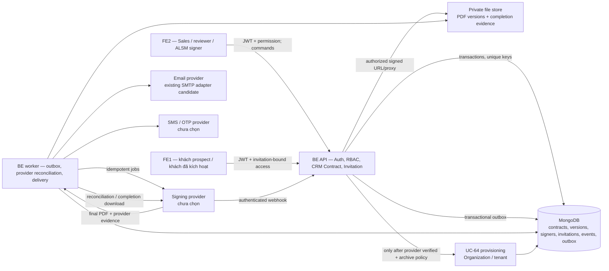

# 02 — Thiết kế kỹ thuật ký hợp đồng online ALSM

- **Phiên bản:** 0.1 — đề xuất cho Bước 2
- **Nguồn yêu cầu:** [`README.md`](README.md) (Bước 1)
- **Tình trạng:** thiết kế đề xuất; chưa được Business/Legal/Security/Engineering phê duyệt và chưa triển khai.
- **Lưu ý phạm vi:** API/collection/key dưới đây là hợp đồng thiết kế để review, không khẳng định đã tồn tại trong hệ thống.

## 1. Cơ sở và quy ước

Các phần dưới đây gắn nhãn rõ ràng:

- **[Đã biết từ khảo sát]**: hiện trạng đọc được trong repository.
- **[Đề xuất kỹ thuật]**: giải pháp đề xuất để đạt yêu cầu Bước 1.
- **[Cần quyết định]**: lựa chọn của Business/Legal/Security/Engineering hoặc phụ thuộc nhà cung cấp chưa được chốt.

**Yêu cầu sản phẩm đã xác nhận:** khách phải có account ALSM và đăng nhập trước khi xem/ký; prospect chỉ được tạo từ invitation hợp lệ và không có Organization/tenant/service access trước khi activation; sau khi hoàn tất phải tải được PDF và evidence; MATBAO Sign chưa được chọn; VNPT eContract được chọn riêng cho đánh giá sandbox, chưa phải production; OTP/ảnh chữ ký/hash tự tạo/FE status không phải bằng chứng ký thật.

Mọi mô hình dữ liệu, collection, API path, permission key, status, adapter interface và quy tắc vận hành trong tài liệu này là **đề xuất kỹ thuật để review**, không phải quyết định đã được duyệt. Chúng không xác nhận hiệu lực pháp lý của OTP/chữ ký/provider cụ thể.

**[Đã biết từ khảo sát]** BE hiện là NestJS + MongoDB/Mongoose. Contract metadata nằm trong `Lead.contracts`; UC-63 tạo draft có idempotency và audit; endpoint send/sign hiện chỉ đổi trạng thái; UC-64 tạo Organization trong Mongo transaction. FE2 có CRM page, nhưng một phần quote/payment vẫn dùng local `crm-store`; FE1 `/auth/register` qua BE hiện tạo Organization `SELF_SERVICE`. BE có RBAC, in-app notification, SMTP adapter; chưa thấy signing provider/SMS/provider webhook/PDF contract storage.

**[Đề xuất kỹ thuật]** Tài liệu thiết kế không chọn signing provider. Interface phải provider-neutral cho đến khi có tài liệu API chính thức, capability matrix và sandbox credentials. Không dùng `envelopeId` ngẫu nhiên, API sign mô phỏng hoặc FE local store trong production.

## 2. Sơ đồ thành phần và luồng



**Ranh giới tin cậy:** FE1/FE2 không phải nguồn chân lý về quyền, trạng thái ký hay tenant activation. Backend kiểm tra actor, resource, state transition và provider event. File store chỉ phục vụ qua authorization backend hoặc signed URL ngắn hạn. Provider callback là dữ liệu không tin cậy cho đến khi xác thực chữ ký/nguồn, event identity và transaction.

## 3. Mô hình dữ liệu đề xuất

### 3.1 Chọn Contract aggregate/collection riêng

**[Đề xuất kỹ thuật, chưa được duyệt] Chọn collection `contracts` riêng thay vì tiếp tục nhúng toàn bộ hợp đồng trong Lead.** Lead giữ `contractIds`/summary hoặc được truy vấn bằng `leadId`; contract là aggregate quản lý phiên bản, nhiều signer, provider transactions, tài liệu, event và trạng thái dài hạn.

Lý do: contract có vòng đời độc lập với Lead; cần nhiều phiên bản bất biến, nhiều người ký, retry/webhook idempotency, evidence/file references, access policy và activation gate. Mảng nhúng khiến update nhiều actor/provider rủi ro race, tăng document size, giới hạn unique constraints/idempotency trên subdocuments và làm audit/reconciliation khó mở rộng. Giữ nguyên Lead metadata đơn thuần sẽ tiếp tục kết hợp dữ liệu CRM với hồ sơ pháp lý/tài liệu.

**Chiến lược chuyển đổi tương thích (chưa chạy):**

1. Thêm collection/index/API mới theo hướng additive; giữ các endpoint CRM cũ đọc được trong giai đoạn chuyển tiếp.
2. Backfill mỗi Lead contract thành `contracts` + version snapshot `LEGACY_UNVERIFIED`, giữ nguyên legacy ID/number/Lead relation/timestamps/field gốc. Lưu nguồn legacy để truy nguyên.
3. Coi mọi legacy `SIGNED`, `FULLY_SIGNED`, `SENT_FOR_SIGNATURE`, envelope/hash/URL chưa có provider evidence là **unverified legacy state**. Không tự chuyển thành ký thật, không cho phép activation dựa trên chúng. Draft legacy có thể được xem/tái lập thành version mới sau kiểm tra/duyệt, nhưng không được coi như bản đã phát hành.
4. Dùng migration command có dry-run, report count/rejects, idempotent upsert theo `legacyLeadId + legacyContractId`; chỉ chạy sau khi có kế hoạch backup, phê duyệt và cửa sổ triển khai. Không dùng Mongoose auto-migration lúc khởi động.
5. Dual-read tạm thời: contract mới đọc collection; legacy fallback chỉ để hiển thị nhãn cũ/legacy-unverified. Ghi mới vào collection riêng. Không dual-write trạng thái ký giữa hai nơi như hai nguồn chân lý.
6. Reconcile số lượng, ID, Lead linkage, version/hash nguồn, lỗi backfill và activation candidates trước khi chuyển UI/API hoàn toàn. Giữ read-only legacy fields trong thời hạn tương thích đã chốt; sau đó ngừng ghi/xóa theo retention được duyệt.
7. Mọi chuyển trạng thái nội bộ + audit + outbox phải trong một Mongo transaction khi khả dụng. Gọi provider/email/SMS/file store nằm ngoài transaction qua outbox/state machine; lưu intent trước, xử lý idempotent và reconcile thay vì giả vờ có distributed transaction.

### 3.2 Collections và quan hệ

| Collection (đề xuất) | Dữ liệu / khóa chính | Ràng buộc và quan hệ |
|---|---|---|
| `contracts` | `contractId`, `leadId`, `organizationId`/sales scope, `contractNumber`, `currentVersionId`, `lifecycleStatus`, `environment`, `activationStatus`, `createdBy`, timestamps, `revision`. | Index `{leadId, createdAt}`; `contractNumber` unique theo namespace đã chốt; optimistic revision. Chứa summary, không PDF bytes. |
| `contract_versions` | `versionId`, `contractId`, `versionNumber`, template/version, canonical field snapshot, parties, terms, currency/value, effective-date policy, signer manifest, `contentDigest`, `sourcePdfObjectKey`, created/approved metadata, immutable flag. | Unique `{contractId, versionNumber}`. Khi gửi provider không sửa; version tiếp theo là record mới. `contentDigest` chỉ digest payload/file được định nghĩa, không chứng minh chữ ký. |
| `contract_signers` hoặc signer subdocuments | `signerId`, `contractId`, `versionId`, party (`ALSM`/`CUSTOMER`), order/group, user/account ref, legal identity/authority reference tối thiểu, verified channels refs, provider signer ref, status, signedAt từ provider. | Mỗi signer thuộc đúng version. Tránh lưu OTP; phone hiển thị/mã hóa hoặc reference tới profile theo policy. Index unique theo `{versionId, signerKey}`. |
| `contract_invitations` | `invitationId`, `leadId`, `contractId` optional, target email normalized, intended signer, token hash, expires/revoked/consumed, consumed user ID, verification requirements, delivery status, audit refs. | Unique token hash; invitation chỉ consume một lần bằng compare-and-set/transaction. Không chứa token plaintext. Một invitation chỉ gắn một intended signer/Lead. |
| `provider_transactions` | `transactionId`, provider key/account/environment, `contractId`, `versionId`, purpose (ALSM/customer/cancel/download), idempotency key, provider envelope/session ID, request correlation, status, attempt/reconciliation metadata, timestamps. | Unique `{provider, environment, accountRef, idempotencyKey}` và/hoặc provider transaction ID. Secrets không lưu ở record. |
| `provider_events` | provider/account/environment, event ID, transaction ID, event type/time, receivedAt, verified status, payload digest, minimal normalized data, processing state/error class. | Unique `{provider, environment, accountRef, eventId}`. Payload thô chỉ nếu policy cho phép; redact secrets/OTP/PII dư thừa. |
| `contract_evidence` | `evidenceId`, contract/version/signer refs, evidence type, provider reference, private object key, MIME/size, SHA-256 (hoặc algorithm đã chốt) trên bytes, bytes length, downloadedAt, verification status, retention class. | Unique theo `{versionId, providerDocumentId/evidenceType}`; immutable object/version; activation policy kiểm tra bộ evidence bắt buộc. |
| `contract_outbox` | event/job ID, aggregate/version, command type, payload ref tối thiểu, attempts, `nextAttemptAt`, status, created/processed. | Unique event/command idempotency. Worker claim lease; retry có backoff/DLQ/alert. Không lưu secrets/OTP. |
| `audit_logs` hiện hữu | Actor, action, resource, timestamp/correlation, metadata an toàn. | Tiếp tục audit nghiệp vụ; provider event details trỏ về refs, không ghi tài liệu/OTP/secret vào metadata. |

Quan hệ: `Lead 1 — N Contract 1 — N ContractVersion 1 — N Signer`; mỗi version có thể có `0..N ProviderTransaction`, `0..N ProviderEvent`, `0..N Evidence`; invitation thuộc một Lead và có thể scope tới contract/version/signer. `contractId + versionId` là ngữ cảnh bắt buộc trong mọi ký, event và evidence.

### 3.3 Contract/version/signer/event definitions

- **Contract:** hồ sơ thương mại dài hạn gắn một Lead và các bên; status summary là trạng thái hiện hành. Không đồng nghĩa file PDF.
- **ContractVersion:** snapshot bất biến của nội dung, giá, điều khoản, template và signer manifest. Mọi chữ ký/evidence/provider operation tham chiếu chính xác version.
- **Signer:** người/đại diện của một bên được yêu cầu ký với order/group và status riêng; user account không tự chứng minh thẩm quyền pháp nhân.
- **Invitation:** secret capability dùng một lần để bắt đầu xác minh/liên kết một account với đúng Lead/signer; token hash lưu ở BE, token không cấp quyền tenant.
- **ProviderTransaction:** một hành động gửi/khởi tạo/ký/hủy/tải đối với provider và version. Có idempotency key, correlation và trạng thái reconcile.
- **ProviderEvent:** callback hoặc kết quả polling. Chỉ event xác thực, khớp account/environment/transaction/version và hợp lệ theo state machine mới tác động trạng thái.
- **Evidence:** artifact provider thực sự trả về (final PDF, completion certificate/receipt nếu có) hoặc audit event nội bộ có provenance. Nội bộ không tự tạo provider certificate.

## 4. Trạng thái hợp đồng và partial signing

### 4.1 Mô hình trạng thái

**[Đề xuất kỹ thuật]** Giữ `lifecycleStatus` cho workflow + các trường độc lập `providerCompletionStatus`, `archiveStatus`, `activationStatus`. Không ép tình trạng tải file vào một cờ “đã/chưa ký”.

Workflow states: `DRAFT`, `INTERNAL_REVIEW`, `READY_FOR_SIGNATURE`, `ALSM_SIGNING_IN_PROGRESS`, `ALSM_PARTIALLY_SIGNED`, `ALSM_SIGNED`, `SENT_TO_CUSTOMER`, `CUSTOMER_VIEWED`, `CUSTOMER_SIGNING_IN_PROGRESS`, `CUSTOMER_PARTIALLY_SIGNED`, `CUSTOMER_SIGNED`, `CHANGES_REQUESTED`, `REJECTED`, `EXPIRED`, `CANCELLED`, `PROVIDER_ERROR`, `LEGACY_UNVERIFIED`.

Sau khi provider xác nhận đủ chữ ký: đặt `providerCompletionStatus=CONFIRMED` và lifecycle `PROVIDER_COMPLETED_EVIDENCE_PENDING` (hoặc `PROVIDER_COMPLETED_EVIDENCE_FAILED` khi tải/lưu đã lỗi). UI phải nói rõ **“Provider đã xác nhận, đang xử lý hồ sơ”** và hiển thị đúng provider-confirmed state; không trình bày như khách chưa ký. Giữ provider transaction/event reference, signer results và timestamps đã xác minh; chạy tải lại/đối soát bằng provider document ID. Chỉ chuyển lifecycle `COMPLETED` khi PDF/evidence policy đã được lưu và kiểm tra. Khách đăng nhập và có grant đúng mới được tải PDF cuối cùng cùng hồ sơ evidence sau khi hoàn tất. `activationStatus` riêng: `NOT_ELIGIBLE`, `ELIGIBLE`, `REQUESTED`, `COMPLETED`, `FAILED_RETRYABLE`, `RECONCILIATION_REQUIRED`.

`PROVIDER_COMPLETED_EVIDENCE_PENDING/FAILED` luôn chặn UC-64 nhưng giữ provider result/reference, signed timestamps và progress. Worker tải lại bằng provider document ID, kiểm tra kích thước/MIME, checksum trên bytes, ghi private object idempotently rồi mới xét `COMPLETED`. Khi provider completion xác thực nhưng response/download/lưu lỗi, không quay về `SENT_TO_CUSTOMER`/`CUSTOMER_SIGNING_IN_PROGRESS`, không báo khách “chưa ký”, không tạo chữ ký/evidence thay thế; mở reconciliation/alert cho tới khi PDF/evidence tải được hoặc có quy trình xử lý được duyệt.

### 4.2 Nhiều người ký

**[Đề xuất tạm thời cần Business/Legal xác nhận]** Mặc định có tối thiểu một signer có thẩm quyền mỗi bên; thứ tự tuần tự ALSM trước, toàn bộ signer ALSM hoàn tất rồi mới mở cho khách. Nếu bên nào có nhiều signer, yêu cầu tất cả signer trong manifest ký; không coi chữ ký một signer là hoàn tất hợp đồng. Đây chỉ là default vận hành để thiết kế state model, không kết luận pháp lý.

- Mỗi signer có state riêng: `PENDING`, `INVITED`, `VIEWED`, `OTP_PENDING`, `SIGNED_CONFIRMED`, `DECLINED`, `EXPIRED`, `CANCELLED`, `ERROR`.
- `*_PARTIALLY_SIGNED` phản ánh ít nhất một nhưng chưa đủ signer trong cùng party/order group đã được provider xác nhận. UI hiển thị progress, không hiện `COMPLETED`.
- Hủy/thay người ký phải thu hồi signer/envelope theo capability provider, lưu audit, kiểm soát lại authority, tạo transaction mới hoặc contract version mới nếu nội dung/manifest thay đổi.
- Provider phải trả participant/signer identity mapping đủ để đối chiếu với manifest; nếu không hỗ trợ, không được suy đoán ai đã ký.
- **[Cần quyết định]** Số signer, đồng thời/tuần tự, người ký thay thế, thứ tự các bên, một người ký nhiều bên và yêu cầu countersign.

## 5. API contract đề xuất

Các path dưới đây là semantic design; ghép với global prefix/API version và conventions thực tế sau review. Commands tạo side effect nhận `Idempotency-Key`; mọi response gồm `requestId`, resource IDs, state/version và actionable error `{code,message,requestId}`. Không nhận `status=SIGNED/COMPLETED` từ FE.

| API đề xuất | Actor/authorization | Input và hành vi |
|---|---|---|
| `POST /crm/leads/{leadId}/contract-invitations` | Sales có permission mời; backend kiểm tra Lead scope/assignment, contact và signer. | `{email, signerName, party, contractId?, versionId?, expiresIn?}`. Tạo token hash, gửi email qua outbox; plaintext token chỉ trả cho delivery worker. Response không lộ token. |
| `POST /auth/prospects/register` | Public nhưng chỉ tạo user khi backend xác thực invitation token còn hạn, chưa thu hồi/consume và gắn đúng Lead/contact; rate limit/anti-enumeration. | `{invitationToken, fullName, password, phone}`. Không nhận email tự do; email lấy từ invitation. Không có invitation hợp lệ thì reject và không tạo user/session. Tạo prospect pending email verification, không tạo Organization. Existing account không qua endpoint tạo user: phải đăng nhập rồi accept invitation. |
| `POST /contract-invitations/resolve` | Public throttled, token trong POST body; chỉ kiểm tra và trả state tối thiểu. | Trả masked recipient, expiry/status/next requirement; không tiết lộ account exists hoặc Lead details, không tạo account, không cấp quyền xem contract. |
| `POST /contract-invitations/{id}/accept` | Authenticated user có email verified; phone verification/authority state được kiểm tra trước khi mở signing; validate token proof và target account/email/identity, một lần. | Atomically consume token và tạo `contract_access`/Lead relation tối thiểu; không thêm Organization member. Phải login trước mọi contract detail/document/evidence read. |
| `POST /contract-invitations/{id}/resend`, `DELETE /.../{id}` | Sales đúng Lead scope; one-time link; rate limit. | Resend rotate token/invalidate prior; revoke có reason. Delivery không tạo trùng invitation/envelope. |
| `GET /contracts/{contractId}` | Sales/reviewer/signers/customer theo resource-level policy. | Metadata/version và fields theo role; prospect chỉ đúng invitation-bound contract. |
| `GET /contracts/{contractId}/versions/{versionId}` | Reviewer/signer/customer được cấp quyền trên đúng version. | Terms, signer progress, rendered PDF preview; không cho đọc version khác nếu policy không cấp. |
| `GET /contracts/{contractId}/versions/{versionId}/document` | Same authorization; download rate/audit. | Backend proxy hoặc signed URL ngắn hạn; check contract status/version, private store access. |
| `POST /contracts/{id}/versions/{versionId}/submit-review` | Sales có `crm.contracts.submit-review`; version DRAFT. | Khóa snapshot/content digest; chuyển `INTERNAL_REVIEW`; không gửi provider. |
| `POST /contracts/{id}/versions/{versionId}/approve` / `.../return` | Reviewer permission, separation-of-duties policy. | Approve và enqueue thông báo khách cùng transaction, sau đó chuyển `SENT_TO_CUSTOMER`; lần đầu khách mở hợp đồng chuyển `CUSTOMER_VIEWED` và ghi audit/thông báo Sales idempotent. `READY_FOR_SIGNATURE` chỉ giữ cho dữ liệu/luồng tương thích cũ hoặc trạng thái trước bước gửi. Return cần reason; mọi thay đổi được audit trong transaction. |
| `POST /contracts/{id}/versions/{versionId}/alsm-signing-sessions` | ALSM signer permission + authority/assignment, approved version. | Khởi tạo provider transaction; trả provider redirect/widget/session data đã được phép công khai. OTP/provider secrets không qua FE. Provider event xác nhận mới cập nhật signer. |
| `POST /contracts/{id}/versions/{versionId}/send-to-customer` | Sales/authorized operator sau `ALSM_SIGNED`, invitation/account liên kết đúng signer. | Tạo customer signing session qua outbox/provider; trả queued/session status; gửi in-app + email, không đánh dấu đã gửi khi provider chưa nhận. |
| `POST /contracts/{id}/versions/{versionId}/customer-signing-sessions` | Authenticated invited signer; đúng phone verified bằng phương thức đã duyệt; `SENT_TO_CUSTOMER`/viewed. | Bắt đầu provider session. Nếu provider/SMS method được duyệt hỗ trợ challenge, yêu cầu OTP tới phone đã xác minh; trả redirect/session. Backend không nhận/lưu OTP code; không có fake OTP fallback. Nếu chưa có phương thức xác minh được duyệt thì chặn signing. |
| `POST /contracts/{id}/versions/{versionId}/decline` | Đúng customer signer đăng nhập và được mời; hoặc provider-confirmed decline. | Customer reason optional theo policy, ghi event/audit; trạng thái cuối chỉ theo xác nhận provider nếu thao tác decline nằm ở provider. Không activation. |
| `POST /contracts/{id}/versions/{versionId}/change-requests` | Đúng customer signer đăng nhập; version đang gửi/xem. | `{reason, fields?}`; ghi yêu cầu, đóng/cancel signing session theo provider, `CHANGES_REQUESTED`; revision mới phải quay lại review. |
| `POST /integrations/signing/{providerKey}/webhooks` | Không JWT user; provider signature/HMAC/mTLS/allowlist theo spec, timestamp/replay guard. | Verify raw request; resolve configured environment/account; idempotent insert event; enqueue processing. Invalid callback không sửa business state. |
| `POST /admin/contracts/{id}/provider-reconciliation` | Ops/Security permission; audited. | Queue provider status poll by transaction ID; no arbitrary status/body supplied by operator. |
| `GET /contracts/{id}/versions/{versionId}/evidence` | Contract signer/authorized staff after policy. | Evidence manifest and availability; no public object keys. |
| `GET /contracts/{id}/versions/{versionId}/evidence/{evidenceId}/download` | Same resource check, audit and short-lived download. | Download provider-returned artifact through backend/private signed URL. |
| `POST /crm/leads/{leadId}/activate` (existing UC-64) | Existing sales permission + backend eligibility. | Backend resolves all contract gates itself; request cannot pass `signed=true`, `paid=true`, provider ID or bypass flag. Idempotent by contract/Lead. |

**Response state shape proposal:**

```json
{
  "contractId": "…",
  "leadId": "…",
  "currentVersionId": "…",
  "lifecycleStatus": "PROVIDER_COMPLETED_EVIDENCE_PENDING",
  "providerCompletionStatus": "CONFIRMED",
  "archiveStatus": "PDF_DOWNLOAD_RETRYING",
  "activationStatus": "NOT_ELIGIBLE",
  "signers": [{"signerId": "…", "party": "CUSTOMER", "status": "SIGNED_CONFIRMED"}],
  "requestId": "…"
}
```

## 6. Backend authorization và identity

- FE permission checks (`hasPermission`) chỉ điều khiển trải nghiệm; BE guards và application service là policy enforcement point.
- Mỗi API lấy actor từ validated session/JWT; truy vấn contract bằng ID trong cùng điều kiện tenant/Lead scope/assignment/invitation relationship. Không làm kiểu load-by-ID rồi chỉ dựa client-provided `leadId`.
- Sales chỉ truy cập Lead theo sales organization/assignment policy; reviewer chỉ contract queue được giao; signer chỉ signer record của mình và đúng version; prospect access phải có accepted invitation link và active contract grant. Admin access cần permission riêng + audit.
- Prospect account không được thêm Organization membership hay project scope từ invitation. `/auth/me` roles/permissions không được coi prospect là `OWNER` qua Organization role; role prospect/contract grant độc lập.
- Signed-in session và email verification không đủ chứng minh legal authority. Authority verification/representation reference cần policy; không lưu giấy tờ nhạy cảm nếu chưa có căn cứ và retention.
- Webhook identity là service identity độc lập. Chỉ raw-body signature verification theo provider document, environment/account matching, timestamp tolerance, nonce/event id, replay dedupe và transaction state guard được phép ghi event verified.
- Download tài liệu/evidence kiểm tra contract+version+signer grant ở BE mỗi lần; object store bucket private, không dùng `pdfUrl` public cố định.
- Admin override không thể tự đặt event `COMPLETED`; trường hợp break-glass phải có double approval/legal ops policy, audit rõ và không giả làm provider event.

### 6.1 Tách prospect registration khỏi self-service registration

**[Đã biết từ khảo sát]** `AuthService.register` hiện hash password, tạo user, tạo Organization `SELF_SERVICE`, membership `OWNER`, audit rồi gửi email verification. FE1 gọi endpoint `/auth/register`.

**[Đề xuất kỹ thuật]** Không đổi ngầm semantics `/auth/register`. Thêm intent riêng `/auth/prospects/register` nhưng chỉ cho phép khi backend xác minh invitation hợp lệ; endpoint không nhận đăng ký prospect độc lập. Nếu invitation sai/hết hạn/đã dùng/thu hồi/không khớp Lead/contact, reject trước khi tạo user. Flow prospect:

1. Validate invitation trước khi tạo user; email identity lấy từ invitation và normalize, không cho sửa recipient qua FE. Invitation resolve public chỉ trả thông tin masked và không tạo user hoặc cấp contract access.
2. Tạo hoặc lấy user atomically theo unique email; state `PROSPECT_PENDING_VERIFICATION`; không tạo Organization/membership/tenant/subscription.
3. Existing user: yêu cầu login rồi mới accept; không qua endpoint tạo prospect, không reset password, không thay email, không gắn Lead trước khi account identity khớp và invitation được consume một lần.
4. Xác minh email trong onboarding. Xác minh số điện thoại trước khi ký bằng phương thức provider/SMS đã được duyệt; không tạo OTP giả. Invitation acceptance một lần tạo contract access grant. Session/auth payload nêu account type/prospect scope nhưng không cấp permission dịch vụ.
5. Duy trì luồng `/auth/register` self-service hiện hữu và user hiện có. Nếu product muốn thay đổi self-service thì phải có quyết định riêng, migration/compatibility plan và review affected flows.
6. UC-64 chỉ sau eligible completion mới transactionally tạo Organization, gắn đúng user khách theo accepted invitation/signing identity/approved mapping; xử lý existing organization/user và duplicate/retry theo chính sách riêng.

**[Đã xác nhận]** Không có invitation hợp lệ thì khách không được tạo account prospect qua API mới. Prospect không có Organization/tenant/service access cho tới khi UC-64 activation đủ điều kiện hoàn tất. **[Cần quyết định]** eKYC/identity proof cần mức nào; SMS/provider method xác minh phone; số điện thoại dùng chung giữa account hay signer profile; account prospect chưa liên kết được giữ bao lâu. Các điểm này không mở lại lựa chọn đăng ký prospect tự do.

## 7. Provider-neutral adapter và integration lifecycle

### 7.1 Adapter contract đề xuất

```text
SigningProviderAdapter
  capabilities(environment, accountRef)
  createSigningTransaction(input, idempotencyKey)
  getTransaction(providerTransactionId)
  cancelTransaction(providerTransactionId, reason)
  verifyWebhook(rawBody, headers, configuredAccount) -> VerifiedEvent | Reject
  normalizeEvent(verifiedPayload) -> ProviderEvent
  downloadCompletedArtifacts(providerTransactionId) -> ArtifactStream[]
  createSignerSession(providerTransactionId, signerRef, verifiedPhoneRef?)
```

Types không generic với API cụ thể: `SigningTransactionInput` chứa version, file stream/reference, content digest, signer manifest/order, callback reference, expiration; `SigningSessionResult` trả opaque provider IDs, redirect/widget data an toàn và expiry; `VerifiedEvent` có provider/account/environment/event ID/transaction/version/signer/status/provider timestamp. Secret config inject từ secret manager/config; không nằm trong FE/DB/log.

**Capability gate:** adapter khai báo `supportsOtpToVerifiedPhone`, `supportsMultipleSigners`, `supportsSequentialSigning`, `supportsSignedPdf`, `supportsCompletionEvidence`, `supportsCancel`, `supportsWebhookVerification`, `supportsStatusPolling`, `supportsIdempotency`. Không bật flow yêu cầu capability thiếu; không fallback mô phỏng trong production. MATBAO Sign chưa được chọn; VNPT eContract chỉ được chọn cho sandbox evaluation, nên interface phải chờ credentials, API/version/hostname confirmation và sandbox verification trước khi bật capability.

### 7.2 Gửi, ký, webhook, retry và đối soát

1. Trong transaction BE tạo `provider_transactions` + outbox intent + state pending; key ổn định theo contract/version/action.
2. Worker claim lease và gọi provider ngoài transaction bằng idempotency key/correlation ID. Nếu timeout, ghi trạng thái unknown/pending; trước retry query provider theo idempotency key/external reference.
3. Không giả định provider trả exactly-once hoặc thứ tự event. Persist event id trước xử lý, unique constraint chống duplicate, worker xử lý theo transaction/version/signer và legal transition graph.
4. Webhook xác thực raw bytes và signature theo official spec; timestamp skew limit, event id dedupe, account/environment allowlist, payload schema validation, request rate controls. Callback invalid không enqueue state change.
5. Out-of-order event: persist verified event; nếu thiếu predecessor hoặc trạng thái xung đột, query authoritative provider transaction; không hạ trạng thái đã xác nhận, không tự suy ra `COMPLETED` từ `VIEWED`/`SIGNED` một signer.
6. Scheduled reconciliation poll các pending/unknown transactions; backoff+jitter, max attempts rồi DLQ/ops alert. Không gửi lại lời mời/ký tự động vượt policy.
7. Provider completion verified là nguồn chân lý về signatures. Ghi `providerCompletionStatus=CONFIRMED` ngay cùng provider references và signer timestamps; sau đó archive job download artifacts. Download failure đưa `PROVIDER_COMPLETED_EVIDENCE_PENDING/FAILED`, cảnh báo Ops, retry cùng provider document ID.
8. `COMPLETED` là policy state nội bộ yêu cầu signatures đủ + provider complete verified + bắt buộc evidence được tải/lưu/hash/đọc xác nhận. Activation luôn bị chặn trước đó.
9. Notification gửi sau state commit qua outbox; email/SMS lỗi không undo provider result. Delivery retry độc lập và idempotent theo event + recipient + channel.

### 7.3 File, checksum, backup và retention

- Tài liệu đầu vào tạo từ template đã duyệt thành canonical PDF; lưu private ngay khi version submit/review, ghi digest trên bytes và metadata renderer/template. Chỉ phát hành đúng PDF bytes đã gửi provider.
- Provider hoàn tất trả PDF/evidence: tải stream qua worker; xác thực provider/document/version mapping; kiểm tra content type/size/malware policy, rồi compute checksum trên bytes nhận được; lưu object private với key không chứa email/name, immutable versioning, encryption/KMS theo quyết định region.
- Hash kiểm tra integrity khi upload/download và audit đối chiếu; không thay certificate/provider signature validation.
- Bản gốc và evidence không sửa/xóa thông thường; correction là version/artifact mới có provenance. Quy trình legal hold/retention/delete phải duyệt bởi Legal/Privacy.
- Backup/versioning, restore drill, encryption key rotation, access logs và recovery point/recovery time objectives cần được chốt với Security/Operations. Không dùng sandbox bucket/keys cho production.
- **[Cần quyết định]** store/region, KMS/key ownership, file format/standards, retention, backup, residency và policy artifacts bắt buộc để `COMPLETED`.

## 8. Payment và activation gate UC-64

**[Đã biết từ khảo sát]** BE `ActivateCrmLeadService` hiện kiểm tra `SIGNED`/`FULLY_SIGNED`, tạo Organization Enterprise và cập nhật Lead trong Mongo transaction; implementation được khảo sát không xác minh khoản thanh toán. FE2 `confirmPayment` và `setPaymentPolicy` đang dùng `crm-store`, không phải nguồn thanh toán server đáng tin cậy.

**[Đề xuất kỹ thuật]** Không coi FE flag/payment mock, Lead status hoặc contract signature là thanh toán. Activation service phải tự đọc eligibility server-side:

```text
providerCompletionStatus == CONFIRMED
AND all required signers == SIGNED_CONFIRMED
AND contract version == version referenced by all provider transactions
AND required final PDF/evidence artifacts == VERIFIED_AND_STORED
AND invitation/account/Lead/customer mapping == approved
AND business payment/waiver conditions == satisfied (only after owner decision)
AND environment == production for production tenant
```

Unique provisioning key theo `contractId + versionId` hoặc agreed customer source; Mongo transaction tạo Organization + membership + provisioning record + Lead reference + audit/outbox. External provision calls (subscription/access/welcome) phải có riêng saga/outbox/reconciliation; transaction Mongo không rollback service ngoài.

**[Cần quyết định]** Có cần thanh toán trước? Có miễn/waive? Hệ thống/payment source nào là authority? Chấp nhận invoice/credit terms? Ai xác nhận? Từng điều kiện có apply per engagement type không? Không bật activation trước khi owner ký chính sách.

## 9. Sandbox/production separation

- Cấu hình environment immutable theo deployment: `sandbox`/`production`; provider account, credentials, webhook key, outbound host allowlist, object prefix/bucket, DB labels và notification templates tách riêng.
- Contract và provider transaction lưu `environment`; production API từ chối sandbox transaction/version. Sandbox webhook chỉ tới sandbox host/credential; production endpoint từ chối account/test flag không hợp lệ.
- UC-64 production chỉ được gọi bởi BE production worker/service qua eligibility gate; không có client-controlled environment/status bypass. Sandbox activation chỉ tạo fixture/test tenant trong namespace riêng, không Organization production.
- UI in badge `SANDBOX / DEMO — KHÔNG PHẢI HỢP ĐỒNG ĐÃ KÝ THẬT`; artifacts sandbox watermark/test label; seed data không giả provider evidence thành production.
- CI/deployment secret references qua approved secret manager; no credentials in source, docs, `.env` tracked files, screenshots or logs. Rotation/revocation and access review required.
- Feature flag chỉ tắt/mở integration path theo environment, không fallback tự động sang `simulateSignContract` khi provider lỗi.

## 10. Security / privacy threat list và data boundary

| Threat | Controls to design/review |
|---|---|
| Invitation/token theft, forwarding, replay, enumeration | High-entropy one-time token stored hashed, short expiry, rotate/revoke, rate-limit, masked resolve, bind intended signer/Lead, authenticated acceptance, no analytics/referrer leakage. |
| Account takeover / email-only matching / SIM swap | Existing account login, verified email + phone, provider OTP, risk/authority verification decision, notify on new device/identity link, secure sessions and step-up policy. OTP is not authority proof. |
| IDOR / cross-Lead / cross-tenant access | Backend object-level checks on every read/write/download, invitation grant scoping, deny-by-default, security audit and negative authorization scenarios. |
| Unauthorized internal approval/signing/self-approval | Separate permissions, separation-of-duties, signer authority mapping, explicit version digest confirmation, audit. |
| Contract tampering/version substitution | Immutable canonical snapshot, content digest over exact bytes, provider receives version reference, callback references same digest/version, prevent mutation after approval. |
| Forged/replayed/out-of-order webhook | Raw signature verification, TLS, account/environment binding, timestamp/nonce/event ID, unique event index, state machine and provider polling reconciliation. |
| Provider compromise or over-sharing | Data minimization, approved processor contract, API scopes, encrypted transport, vendor due diligence, DPA, data residency, access and deletion review. |
| OTP abuse / SMS pumping / PII in logs | Provider-controlled OTP preferred, send/verify limits, transaction-bound OTP, short expiry, no OTP logs, delivery budget/alerts, phone encryption/masking. |
| Public/private file leakage or malicious PDF | Private bucket, short-lived authorized downloads, encryption, MIME/size validation, malware scanning policy, safe headers, immutable versioning, access audit. |
| Secret leakage | Secret manager; no credentials in repository/FE/DB application logs; rotation, least privilege, restricted webhook secret. |
| Partial failure and duplicate side effects | Mongo transaction for internal state; outbox for calls; idempotency indexes; reconciliation; DLQ; UC-64 unique provisioning key and transaction. |
| Sandbox contaminates production | Separate accounts/secrets/storage/callbacks; env field immutable; hard production activation allowlist; test watermarks; no fallback simulator. |
| Privacy over-collection/retention/cross-border | Minimize identity evidence; document purpose/legal basis/access/retention; region/subprocessor/transfer review and incident response sign-off. |

**Vendor data boundary — proposed minimum:** send only contract PDF bytes/version digest, signer display name and provider-required contact/verified channel reference, signing order, locale, callback/correlation metadata, and required legal fields. Do not send ALSM login password, internal access/refresh tokens, unrelated Lead notes, other customer data, payment credentials, unnecessary ID documents, or OTP values. If provider needs national ID/eKYC/phone in plaintext, require Legal/Security approval, encrypted transport, storage/retention terms and documented purpose before integration.

## 11. Decisions and legal review remain external

This design does not decide provider, SMS, template, authority, signer sequence, effective date, payment gate, file region/retention, identity proof or legal sufficiency. Keep the checklist in [`README.md`](README.md) and the owner/status list in [`decision-register.md`](decision-register.md). Legal must review applicable Vietnamese law/current implementing rules and contract type before production; this document is not a legal opinion.

## 12. Repository landmarks for implementation review

- **BE:** `src/modules/auth/application/auth.service.ts`, `src/modules/auth/presentation/auth.controller.ts`, `src/modules/rbac/`, `src/modules/crm/presentation/sales-crm.controller.ts`, `src/modules/crm/application/create-contract.service.ts`, `src/modules/crm/application/sales-crm.service.ts`, `src/modules/crm/application/activate-crm-lead.service.ts`, `src/modules/crm/infrastructure/lead.schema.ts`, `src/modules/notifications/`, `src/shared/mail/`, `src/config/environment.validation.ts`.
- **FE1:** `src/features/auth/services/auth.service.ts`, `src/features/auth/pages/RegisterPage.tsx`, `src/app/providers.tsx`, `src/app/guards.tsx`, `src/features/notifications/`.
- **FE2:** `src/features/crm/api/crm.api.ts`, `src/features/crm/pages/LeadDetailPage.tsx`, `src/features/crm/components/CreateContractModal.tsx`, `ContractPreviewModal.tsx`, `CustomerActivationModal.tsx`, `src/features/crm/services/crm-store.ts`.
- Confirm paths/status again before each implementation PR; repository can change after this snapshot. No package/test/migration/Git operation is part of this design document.
