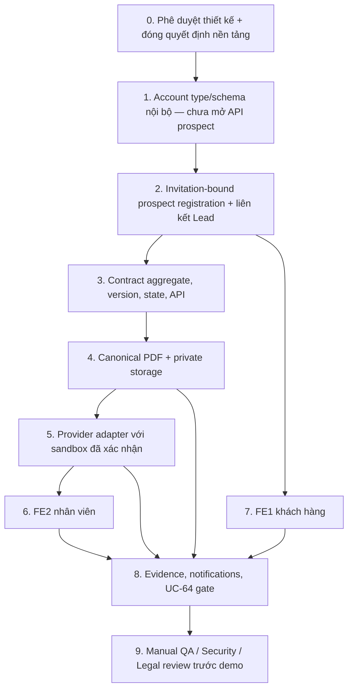

# 03 — Trình tự triển khai ký hợp đồng online ALSM

- **Phiên bản:** 0.1 — kế hoạch phụ thuộc/PR đề xuất
- **Điều kiện bắt đầu:** decision package và thiết kế được owners phê duyệt; danh sách mở nằm tại [`decision-register.md`](decision-register.md). Chỉ bắt đầu lát cắt nền tảng an toàn khi account boundary, compatibility và review schema đã rõ; các quyết định provider/payment có thể còn mở nếu lát cắt không đụng tới chúng.
- **Nguyên tắc chia PR:** một PR theo một repository và một mục tiêu; không gom BE + FE1 + FE2 thành PR lớn. Tài liệu này không thực hiện các bước triển khai.

## Bản đồ phụ thuộc

## 0. Gate — phê duyệt thiết kế (chưa phải code PR)

- **Repository:** tài liệu trong `ALSM_WEB_BE/docs/online-contract-signing/`; review stakeholders trên các repo không làm thay đổi repo.
- **Đầu vào:** Bước 1 và `02-technical-design.md`, `decision-register.md`; API/provider docs chính thức nếu đã chọn.
- **Module sẽ khảo sát lại:** BE auth/RBAC/CRM/notification/payment/transactions; FE1 auth/route/organization bootstrap; FE2 CRM contract/activation; deployment/security/storage setup.
- **Điều kiện hoàn thành:** Legal ký nháy mẫu và authority policy; Business chốt signer/effective date/payment gate; Security chốt PII/vendor/file region; Engineering xác nhận provider capabilities, transaction/outbox plan và compatibility plan. Tối thiểu D-01–D-13 được quyết định hoặc có explicit go/no-go cho phần được hoãn.
- **Rủi ro:** coding trước quyết định provider/legal có thể tạo API/state không thể dùng hoặc phải bỏ.
- **Chờ:** mọi quyết định `OPEN` liên quan đến scope. Nếu provider chưa có docs/sandbox, không bắt đầu PR 5 và không bật production signing.

## 1. PR BE — nền tảng account type/schema nội bộ, chưa mở API prospect

- **Repository:** `ALSM_WEB_BE` chỉ.
- **Phạm vi:** thêm nền tảng account type/prospect state hoặc identity context nội bộ, tách khỏi Organization membership/permission; chưa tạo endpoint đăng ký prospect, chưa tạo user prospect và chưa cho phép user không có invitation tạo account. Giữ nguyên `/auth/register` self-service hiện tại, bao gồm Organization/membership đang được tạo.
- **Đầu vào:** CONF-01/CONF-02; D-11 về verification/authority vẫn mở; account model/auth contract và permission model được review.
- **Module sẽ khảo sát lại:** `src/modules/auth/application/auth.service.ts`, `auth.controller.ts`, auth DTO/user schema, organization provisioning, effective permissions, FE1 `AuthService`/providers/guards để xác nhận response compatibility.
- **Điều kiện hoàn thành:** có thể biểu diễn prospect identity tách biệt khỏi Organization/member/project/service role; chưa có API public tạo prospect; `/auth/register` tiếp tục giữ nguyên hành vi đã có; roles/session không biến prospect thành `OWNER`.
- **Rủi ro:** code hiện tạo Organization trong register; sửa nhầm semantics làm hỏng khách self-service hoặc route consumers.
- **Chờ:** PR này không mở luồng đăng ký prospect. API tạo prospect chỉ được thêm cùng PR invitation-bound ở Bước 2. Email verification phải được xác định trong onboarding; phone phải verified trước khi ký bằng phương thức SMS/provider đã duyệt. Không tạo OTP giả. Chưa cần chọn signing provider để thêm schema nội bộ.

## 2. PR BE — invitation-bound registration, identity verification và liên kết account–Lead

- **Repository:** `ALSM_WEB_BE` chỉ.
- **Phạm vi:** trong cùng PR backend, tạo invitation token hash/expiry/revoke/consume, delivery outbox, registration prospect chỉ khi invitation hợp lệ và đúng Lead/contact, xử lý account đã có/chưa có, verified email, phone-verification gate trước ký, signer/Lead access grant có scope, resend/revoke. Không cấp tenant permission. Endpoint resolve không tạo account hoặc cấp quyền đọc hợp đồng.
- **Đầu vào:** PR 1; D-03, D-06, D-11, D-14; policy anti-enumeration/expiry/rate limits.
- **Module sẽ khảo sát lại:** `src/modules/crm/`, `auth/email-verification.service.ts`, user schema/repository, notification service, SMTP `src/shared/mail`/`auth/infrastructure/smtp-email.adapter.ts`, RBAC/guards.
- **Điều kiện hoàn thành:** user không có invitation hợp lệ không thể tạo prospect account qua API mới; invitation còn hạn, chưa dùng/thu hồi, gắn đúng Lead/contact và consume một lần; account mới chỉ được tạo từ invitation hợp lệ, xác minh email rồi liên kết; account hiện hữu phải đăng nhập rồi mới chấp nhận invitation; verified phone là điều kiện trước khi ký qua phương thức đã duyệt; không tạo OTP giả; account không được thêm Organization membership; audit/delivery không lộ PII/secret.
- **Rủi ro:** email link bị forward, brute-force token, account enumeration, race consume, SIM swap/authority chưa chứng minh.
- **Chờ:** authority/eKYC policy và SMS/provider verification method vẫn cần xác nhận. Không bật signing hoặc giả lập OTP nếu phương thức chưa được duyệt; provider chưa chọn không chặn thiết kế invitation/account, nhưng chặn provider integration/real signing.

## 3. PR BE — Contract aggregate, version/state machine/API nền

- **Repository:** `ALSM_WEB_BE` chỉ.
- **Phạm vi:** collection `contracts`, `contract_versions`, signer records, state guard, resource-level authorization, audit/outbox primitives, API draft/submit review/approve/return/read/download metadata; giữ Lead ID relation. Không tích hợp signing provider.
- **Đầu vào:** PR 2; approved data model; D-04–D-09, D-13, D-17; transaction/index design.
- **Module sẽ khảo sát lại:** `src/modules/crm/application/create-contract.service.ts`, `sales-crm.service.ts`, CRM controller/DTO, lead schema/repository/unit-of-work, audit, transaction runner, permission seed, API version prefix.
- **Điều kiện hoàn thành:** version immutable sau phát hành; unique/idempotency indexes; state transitions server-only; prospect can read only linked contract; legacy status map an toàn `LEGACY_UNVERIFIED`; cấm activation dựa trên trạng thái ký legacy; audit/event transaction atomic.
- **Rủi ro:** Mongo transaction deployment/index readiness, contract history mapping, FE/API compatibility, document size/unique index conflict.
- **Chờ:** template chưa duyệt thì version schema chỉ có versioned fields/template ref, không phát hành production contract. Không tạo provider-specific field contract.

## 4. PR BE — công cụ backfill/tương thích dữ liệu legacy (không tự chạy)

- **Repository:** `ALSM_WEB_BE` chỉ.
- **Phạm vi:** migration/backfill command được review, dry-run/report, idempotent upsert embedded `Lead.contracts` sang collection/version; giữ ID, timestamps, source reference và nhãn `LEGACY_UNVERIFIED`. Không chạy command trong quá trình PR/triển khai trước approval.
- **Đầu vào:** PR 3; backup/restore plan; record counts; D-17; sign-off Business/Legal về xử lý hợp đồng cũ.
- **Module sẽ khảo sát lại:** `lead.schema.ts`, repositories, database transaction/index provisioning, scripts convention, deployment runbook/backup.
- **Điều kiện hoàn thành:** dry-run xác định inserts/skips/rejects; chạy lặp không tạo duplicate; legacy `SIGNED` không trở thành `COMPLETED`; audit/report không in PII/token; rollback/reconcile procedure được viết.
- **Rủi ro:** data loss, duplicate contract, invalid historical shape, operational lock/transaction duration.
- **Chờ:** chỉ chạy sau data owner approval, backup đã xác minh và maintenance plan. User phải biết trạng thái cũ không phải chứng cứ provider.

## 5. PR BE — canonical PDF và private storage

- **Repository:** `ALSM_WEB_BE` chỉ.
- **Phạm vi:** renderer versioned template thành PDF bytes, store adapter/private object API, metadata/digest/hash bytes, authorized preview/download. Chưa gọi provider.
- **Đầu vào:** PR 3; D-04, D-10, D-16; approved legal template/fonts/locale; file-store region/encryption/access/retention decision.
- **Module sẽ khảo sát lại:** `pdfkit` audit PDF use, config validation, `src/shared/mail`, conversion file handling, storage abstractions/deployment infrastructure, logging redaction.
- **Điều kiện hoàn thành:** renderer deterministic/versioned theo tiêu chí chốt; đúng terms and signer manifest; file private, encrypted, immutable/versioned; checksum trên bytes chính xác; download ACL + audit; retention metadata và malware/content validation có owner.
- **Rủi ro:** font/render differences, template content tampering, public object access, PDF renderer vulnerabilities, cross-region/privacy exposure.
- **Chờ:** không phát hành contract thật nếu template/storage chưa được duyệt. Không dùng `/quotes/...pdf` hoặc print HTML làm hợp đồng chuẩn.

## 6. PR BE — provider adapter và sandbox signing flow

- **Repository:** `ALSM_WEB_BE` chỉ.
- **Phạm vi:** implementation adapter cụ thể theo provider đã chọn; create/cancel/status query/signing sessions/OTP capability/webhook verify/event reconciliation/artifact listing, feature/env gates. MATBAO Sign không mặc định.
- **Đầu vào:** PR 2–5; D-01–D-03, D-05–D-08, D-12–D-16; official API/webhook docs, sandbox account/credentials cấp an toàn, data processor/security review.
- **Module sẽ khảo sát lại:** provider adapter ports, config/secret manager, HTTP client conventions, webhook middleware/raw-body handling, outbox/worker/scheduler, deployment callback domains, logging.
- **Điều kiện hoàn thành:** dùng sandbox account thật của provider; signature webhook verified; idempotent submit/event; polling reconciliation; OTP tới verified phone theo capability; multiple signer flows theo quyết định; provider completion ghi `CONFIRMED`; download API xử lý pending evidence; production fail-closed; không có simulator fallback.
- **Rủi ro:** docs/API drift, provider eventual consistency, webhook replay/order, credentials exposure, undocumented rate limits, region/PII transfer.
- **Chờ:** không bắt đầu khi thiếu provider confirmation/docs/sandbox; không dùng mock envelope làm completion evidence. Production enablement đợi Legal/Security sign-off.

## 7. PR FE2 — giao diện nhân viên (Sales/reviewer/ALSM signer)

- **Repository:** `ALSM_WEB_FE_2` chỉ.
- **Phạm vi:** màn hình tạo draft/version, invitation status, review/return/approve, ALSM signer session, gửi khách, event/status progress, provider/archive errors; xóa nhãn “simulate” khỏi production flow và phân biệt rõ sandbox demo.
- **Đầu vào:** BE APIs ổn định qua PR 2–6; D-04–D-08, D-12–D-15; UX permission matrix.
- **Module sẽ khảo sát lại:** `src/features/crm/api/crm.api.ts`, `LeadDetailPage.tsx`, `CreateContractModal.tsx`, `ContractPreviewModal.tsx`, `CustomerActivationModal.tsx`, `crm-store.ts`, auth/permission hooks.
- **Điều kiện hoàn thành:** mọi thao tác qua BE APIs; local store không giả status/sign/payment trong production path; UI cho thấy version/signer/approval/provider/archive states chính xác; permission UX hỗ trợ bàn phím nhưng backend vẫn quyết định; duplicate action disabled và idempotency key giữ qua retry.
- **Rủi ro:** CRM quote/payment flow local-store có thể lẫn với hợp đồng; legacy data status `SIGNED` có thể bị hiểu nhầm; permission display mismatch.
- **Chờ:** API chưa ổn định thì chỉ chuẩn bị component/interface branch riêng, không mock hiển thị như đã ký thật. Sales/reviewer/signer permissions và wording chờ Business/Legal.

## 8. PR FE1 — giao diện khách prospect và khách hàng

- **Repository:** `ALSM_WEB_FE_1` chỉ.
- **Phạm vi:** invitation landing/login/register prospect, email/phone verification, accept invitation, contract list/detail đúng grant, PDF viewer/download, signing provider redirect/widget, decline/change request, completion state.
- **Đầu vào:** BE invitation/auth/document APIs PR 1–5; provider session API PR 6; D-03, D-06–D-08, D-11, D-12.
- **Module sẽ khảo sát lại:** `src/features/auth/services/auth.service.ts`, `RegisterPage.tsx`, `VerifyEmailPage.tsx`, `app/providers.tsx`, `app/guards.tsx`, routes, notifications, FE1 organization bootstrap and existing login regressions.
- **Điều kiện hoàn thành:** prospect path không trigger self-service Organization creation; account hiện hữu signin trước; invitation không cho xem Lead khác; ký chỉ qua provider; OTP code không lưu ở FE; session expire/reload/retry UX không tự ký; notification không lộ document publicly.
- **Rủi ro:** `/auth/register` behavior cần giữ nguyên; FE1 navigation/auth state có thể giả định user luôn có Organization; link/referrer leakage; browser redirect return URLs.
- **Chờ:** provider widget/redirect CSP/origin rules và invitation/identity policy; chưa render legal terms chưa duyệt.

## 9. PR BE — completion evidence, notification và UC-64 activation gate

- **Repository:** `ALSM_WEB_BE` chỉ.
- **Phạm vi:** worker tải PDF/evidence từ provider, checksum/immutable store, archive state machine `PROVIDER_COMPLETED_EVIDENCE_PENDING/FAILED`, delivery notification/email, activation eligibility gate và idempotent UC-64 linking.
- **Đầu vào:** PR 3, 5, 6; FE2/FE1 API integration decisions; D-08–D-16; Legal/Business decision về evidence bắt buộc/payment gate/tenant mapping.
- **Module sẽ khảo sát lại:** `activate-crm-lead.service.ts`, `sales-crm.controller.ts`, organization schema/repository, billing/payment authority, notifications service, mail service, transaction/outbox/worker, evidence storage.
- **Điều kiện hoàn thành:** provider-confirmed signature vẫn hiển thị xác nhận ngay cả khi archive lỗi; activation bị chặn khi evidence/policy chưa đủ; final PDF/evidence tải/lưu/checksum verify; customer và ALSM nhận thông báo idempotent; UC-64 chỉ chạy sau gate; duplicate activation không tạo organization trùng; payment state chỉ từ source đã được owner chốt.
- **Rủi ro:** provider confirm nhưng artifact unavailable, transaction/outbox partial failure, unknown payment policy, mapping existing user/org, external provisioning ngoài Mongo transaction.
- **Chờ:** D-09, D-10, D-13, D-14 và authority mapping chưa đóng thì giữ activation gate fail-closed, không production launch.

## 10. Manual QA / review trước demo

- **Repository:** thao tác QA qua environment đã được phê duyệt; fix được chia PR riêng từng repository. Không commit data fixtures/secrets hoặc screenshots có PII.
- **Đầu vào:** các PR 1–9 deployed sandbox; provider sandbox configured; test identities/numbers/email được chủ hệ thống cho phép; Legal/Security/Business review checklist.
- **Module sẽ khảo sát lại:** end-to-end FE1/FE2/BE, permission guards, provider dashboard/webhooks, private file store, notification delivery, UC-64/provisioning namespace, audit/alerts.
- **Điều kiện hoàn thành:** manual scenarios cho invitation mới/đã có account, wrong user, expiry/revoke, email/phone verify, signer authority, multi-signer/partial, decline/change request, OTP error, forged/duplicate/out-of-order/late webhook, provider outage, artifact download failure, idempotent retries, no premature activation, sandbox/production separation, file ACL and audit export. Evidence là test record đã scrub PII.
- **Rủi ro:** sandbox có hành vi khác production; provider SMS thật phát sinh chi phí; sai cấu hình callback/store; dữ liệu thử lọt vào production.
- **Chờ:** không dùng hồ sơ thật nếu chưa có data/legal approval; không trình diễn simulator với nhãn “signed”; production/demo sign-off cần Business, Legal, Security và Engineering.

## Cross-cutting release rules

- Mỗi PR cần owner/reviewer, migration/compatibility notes (nếu có), API contract, observability/redaction check, rollback/reconcile plan và feature flag/environment behavior.
- Không merge PR tích hợp provider nếu secrets/docs/sandbox chưa được cấp qua kênh an toàn; không đưa secrets vào source, sample fixtures, Markdown, commit message hoặc test snapshots.
- Migration/backfill là lệnh triển khai có approval riêng; không chạy tự động lúc BE startup. Backfill ký cũ thành `LEGACY_UNVERIFIED`, không cấp activation.
- Không cho production bật provider/activation cho tới khi checklist pháp lý được chuyên gia xử lý, security review xong và tất cả quyết định critical trong register đóng.

## First implementation slice — BE account type/schema nội bộ (đề xuất, chưa triển khai)

- **Repository/module:** chỉ `ALSM_WEB_BE`; khảo sát lại `src/modules/auth` (user schema/repository, auth service/controller, session/permission mapping), organization membership/bootstrap, validation/config và các caller hiện hữu của `/auth/register`.
- **Phạm vi chính xác:** thêm khả năng biểu diễn loại account/state prospect nội bộ và quy tắc domain/schema để prospect không mang Organization membership, tenant/project/service permissions. Giữ `/auth/register` self-service hiện tại nguyên semantics. Chưa mở bất kỳ API public nào tạo prospect; prospect chỉ được tạo khi lát cắt invitation-bound ở Bước 2 sẵn sàng.
- **Ngoài phạm vi:** tạo prospect user; invitation/email delivery; phone/SMS/OTP; thay đổi đăng ký self-service; contract/version/API; PDF/store; provider signing; FE1/FE2; migration/backfill dữ liệu; UC-64/payment gate. Không tạo OTP giả, provider ID giả hoặc signed status giả.
- **Điều kiện trước khi bắt đầu:** thiết kế account type và trạng thái được Engineering/Security review; đã rà callers để bảo toàn self-service; CONF-01/CONF-02 là yêu cầu sản phẩm; có kế hoạch tương thích schema/index/deployment được review. Không cần provider credentials cho lát cắt này và không yêu cầu chúng ở giai đoạn tài liệu.
- **Tiêu chí nghiệm thu:** account model phân biệt prospect khỏi Organization; không có endpoint/route/service tạo account prospect không cần invitation; `/auth/register` tiếp tục tạo Organization self-service như hiện tại; prospect không được cấp tenant/service permissions; serialization/session/role mapping không vô tình trả prospect thành Organization `OWNER`; tài liệu PR ghi rõ chưa có prospect registration/API.
- **Bảo toàn working tree:** ở thời điểm implementation chỉ stage các file BE thuộc lát cắt đã review, không dùng `git add .`; giữ nguyên thay đổi chưa commit trong FE1 và các file lạ/untracked FE2. Nếu workspace có thay đổi BE ngoài phạm vi, không đưa chúng vào PR; ghi nhận và để nguyên cho chủ sở hữu. Lần tài liệu này không thực hiện bất kỳ thao tác Git nào.

Lát cắt tiếp theo mới được thêm endpoint tạo prospect cùng invitation-bound registration và link Lead trong cùng PR; user không có invitation hợp lệ không thể tạo account prospect qua API mới. Verify email là một phần onboarding; phone phải được xác minh trước khi ký bằng provider/SMS method đã được duyệt. Chưa có method được duyệt thì signing bị chặn, không sinh OTP mô phỏng.
