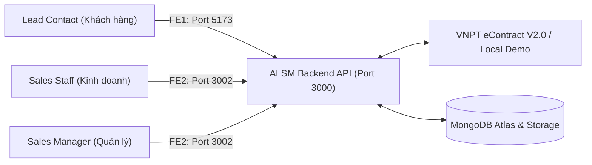
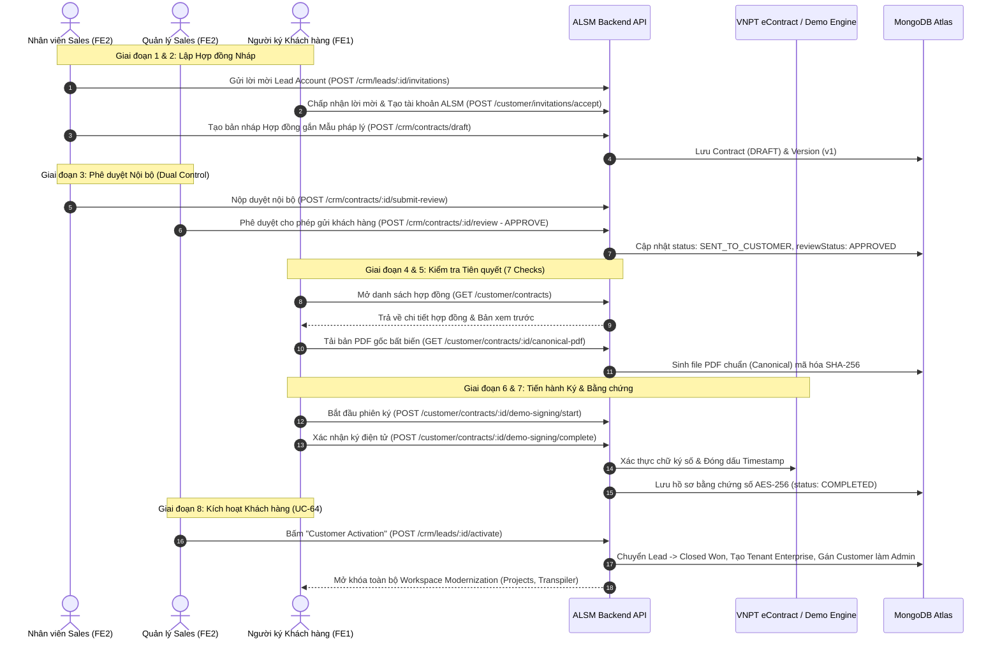

# HƯỚNG DẪN TOÀN DIỆN LUỒNG KÝ HỢP ĐỒNG ĐIỆN TỬ TRỰC TUYẾN ALSM
## (ALSM Online Contract Signing System — End-to-End Architecture, Workflows & Operational Manual)

> **Dự án**: ALSM — Automating Legacy System Modernization  
> **Phạm vi tài liệu**: Quy trình ký kết hợp đồng thương mại điện tử trực tuyến, tích hợp chữ ký số VNPT eContract và mô phỏng Sandbox DEMO, đối soát bằng chứng số bảo mật và kích hoạt khách hàng doanh nghiệp (UC-64, UC-66, UC-70).  
> **Các phân hệ áp dụng**:
> - **Backend API**: `ALSM_WEB_BE` (NestJS, MongoDB Atlas, AES-256-GCM Storage, Redis, BullMQ)
> - **Cổng Khách hàng (FE1)**: `ALSM_WEB_FE_1` (React, Vite, Tailwind CSS — Cổng Customer Portal, Port 5173)
> - **Cổng Nội bộ Kinh doanh (FE2)**: `ALSM_WEB_FE_2` (React, Vite, Tailwind CSS — Cổng Staff CRM & Sales, Port 3002)

---

## MỤC LỤC
1. [Tổng quan Kiến trúc & Nguyên tắc Pháp lý](#1-tổng-quan-kiến-trúc--nguyên-tắc-pháp-lý)
2. [Hai Chế độ Ký kết: DEMO vs PRODUCTION (VNPT eContract)](#2-hai-chế-độ-ký-kết-demo-vs-production-vnpt-econtract)
3. [Quy trình Nghiệp vụ Đầu-Cuối (End-to-End Workflow)](#3-quy-trình-nghiệp-vụ-đầu-cuối-end-to-end-workflow)
   - [Giai đoạn 1: Lời mời & Liên kết Tài khoản Khách hàng](#giai-đoạn-1-lời-mời--liên-kết-tài-khoản-khách-hàng)
   - [Giai đoạn 2: Khởi tạo Bản nháp Hợp đồng (FE2)](#giai-đoạn-2-khởi-tạo-bản-nháp-hợp-đồng-fe2)
   - [Giai đoạn 3: Phê duyệt Nội bộ 2 Cấp (Dual-Control Approval - FE2)](#giai-đoạn-3-phê-duyệt-nội-bộ-2-cấp-dual-control-approval---fe2)
   - [Giai đoạn 4: Khách hàng Tiếp nhận & Xem xét Hợp đồng (FE1)](#giai-đoạn-4-khách-hàng-tiếp-nhận--xem-xét-hợp-đồng-fe1)
   - [Giai đoạn 5: 7 Điều kiện Tiên quyết Ký kết (Readiness Checks)](#giai-đoạn-5-7-điều-kiện-tiên-quyết-ký-kết-readiness-checks)
   - [Giai đoạn 6: Tiến hành Ký kết Trực tuyến (Signing Execution)](#giai-đoạn-6-tiến-hành-ký-kết-trực-tuyến-signing-execution)
   - [Giai đoạn 7: Đóng gói & Lưu trữ Bằng chứng Pháp lý (Evidence Archive)](#giai-đoạn-7-đóng-gói--lưu-trữ-bằng-chứng-pháp-lý-evidence-archive)
   - [Giai đoạn 8: Kích hoạt Khách hàng & Cấp quyền Doanh nghiệp (Activation - UC-64)](#giai-đoạn-8-kích-hoạt-khách-hàng--cấp-quyền-doanh-nghiệp-activation---uc-64)
4. [Mô hình Dữ liệu MongoDB (Data Models & Schemas)](#4-mô-hình-dữ-liệu-mongodb-data-models--schemas)
5. [Danh mục API Chi tiết (REST API Specifications)](#5-danh-mục-api-chi-tiết-rest-api-specifications)
6. [Bảng Mã Lỗi & Cách Khắc phục (Troubleshooting Guide)](#6-bảng-mã-lỗi--cách-khắc-phục-troubleshooting-guide)
7. [Hướng dẫn Cài đặt & Chạy Thử nghiệm (Playbook)](#7-hướng-dẫn-cài-đặt--chạy-thử-nghiệm-playbook)

---

## 1. TỔNG QUAN KIẾN TRÚC & NGUYÊN TẮC PHÁP LÝ

### 1.1. Mục tiêu Nghiệp vụ
Nền tảng ALSM hiện đại hóa hệ thống kế thừa (Legacy Systems) sang Java/TypeScript Spring Boot. Luồng Hợp đồng trực tuyến giải quyết bài toán:
- Tự động hóa ký kết hợp đồng dịch vụ phần mềm không dùng giấy tờ.
- Đảm bảo tính ràng buộc pháp lý chặt chẽ theo Luật Giao dịch điện tử Việt Nam.
- Kết nối tự động giữa việc **Ký hợp đồng thành công** và **Cấp quyền tài nguyên chuyển đổi số (Provisioning Tenant)** mà không cần thao tác thủ công.

### 1.2. Tuân thủ Pháp lý & Bảo mật
- **Luật Giao dịch điện tử số 20/2023/QH15**: Chữ ký điện tử / chữ ký số có giá trị pháp lý tương đương chữ ký tay và con dấu doanh nghiệp khi đáp ứng định danh người ký và toàn vẹn dữ liệu.
- **Tiêu chuẩn ISO 32000-1**: Định dạng tài liệu PDF chuẩn, xác thực chứng thư số X.509, chống chỉnh sửa sau khi ký.
- **Kiểm soát 4 mắt (Dual-Control Principle)**: Nhân viên kinh doanh tạo hợp đồng (`createdByUserId`) **tuyệt đối không được phép tự duyệt** hợp đồng của chính mình. Phải có Sales Manager hoặc Quản trị viên độc lập thẩm định.
- **Tính Bất biến (Immutability)**:
  - Mẫu điều khoản pháp lý (`Legal Template`) phải được phê duyệt trước với mã băm `contentDigest` SHA-256.
  - Mỗi lần đàm phán sửa đổi sẽ sinh ra phiên bản hợp đồng mới (`versionNumber + 1`). Phiên bản cũ được lưu vết lịch sử không thể ghi đè.
- **Kho Bằng chứng Số Mã hóa (Encrypted Evidence Archive)**:
  - Bản PDF đã ký và biên bản chứng thực số (Manifest) được mã hóa bằng thuật toán **AES-256-GCM** với khóa xoay vòng `v1`.



---

## 2. HAI CHẾ ĐỘ KÝ KẾT: DEMO VS PRODUCTION (VNPT eCONTRACT)

Backend ALSM hỗ trợ chuyển đổi linh hoạt giữa 2 chế độ thông qua biến môi trường `CONTRACT_SIGNING_MODE`:

| Tiêu chí | Chế độ DEMO (`CONTRACT_SIGNING_MODE=DEMO`) | Chế độ PRODUCTION (`CONTRACT_SIGNING_MODE=VNPT`) |
| :--- | :--- | :--- |
| **Mục đích** | Kiểm thử, chấm thi, demo chức năng, chạy offline/localhost | Ký kết hợp đồng thực tế có giá trị pháp lý |
| **Nhà cung cấp** | `ALSM_DEMO` (Adapter tích hợp sẵn trong backend) | `VNPT_ECONTRACT` (VNPT eContract V2.0.0 API) |
| **Định danh người ký** | Khớp tài khoản email ALSM đã xác minh (`isEmailVerified: true`) | Bắt buộc xác minh Số điện thoại qua SMS OTP + eKYC VNPT |
| **Mã OTP** | Tự động hoàn tất bằng checkbox xác nhận mô phỏng | SMS OTP thực gửi về SIM điện thoại của người ký |
| **Dấu Watermark PDF** | Đóng dấu cảnh báo nổi: `DEMO ONLY - NOT LEGALLY BINDING` | Đóng chứng thư số PKI / Token HSM hợp chuẩn Bộ TTTT |
| **Hồ sơ bằng chứng** | Manifest demo mô phỏng, mã hóa AES-256-GCM | Manifest pháp lý chứa Log ISP, Timestamp CA, Chứng thư VNPT |
| **Kích hoạt UC-64** | Kích hoạt được tổ chức doanh nghiệp trong chế độ DEMO | Chỉ kích hoạt khi có chứng chỉ xác thực số từ VNPT |

---

## 3. QUY TRÌNH NGHIỆP VỤ ĐẦU-CUỐI (END-TO-END WORKFLOW)



---

### Giai đoạn 1: Lời mời & Liên kết Tài khoản Khách hàng
1. Nhân viên kinh doanh vào chi tiết Lead trên FE2 (`/sales/leads/:leadId`).
2. Tại khối **Customer ALSM Account**, nhân viên nhập email người đại diện (`contactEmail`) và bấm gửi lời mời.
3. Backend tạo bản ghi `contract_invitations` và gửi email chứa token kích hoạt an toàn.
4. Khách hàng click link, đăng ký/đăng nhập tài khoản trên FE1 và xác minh email (`isEmailVerified: true`).
5. Khi khách hàng bấm nhận lời mời, Backend tạo bản ghi `contract_access_grants` với trạng thái `ACTIVE`.
   - *Nếu khách hàng chưa liên kết tài khoản, Backend sẽ chặn tạo hợp đồng với lỗi `CUSTOMER_ACCOUNT_NOT_READY`.*

---

### Giai đoạn 2: Khởi tạo Bản nháp Hợp đồng (FE2)
1. Trên trang Lead FE2, nhân viên kinh doanh bấm nút **"Create Contract"**.
2. Modal mở ra, nhân viên chọn:
   - **Approved Legal Template**: Mẫu hợp đồng pháp lý tiếng Việt đã được duyệt (`Hợp đồng Cung cấp Dịch vụ Chuyển đổi Số ALSM`, SHA-256 digest cố định).
   - **Gói dịch vụ**: Enterprise Tier 1 / Tier 2.
   - **Giá trị thường niên (Annual Value)**: Số tiền VND tương ứng với báo giá.
   - **Ngày hiệu lực (Effective Date)**.
3. Nhân viên bấm **"Create Draft"**. Backend kiểm tra tính toàn vẹn (Idempotency Key) và tạo bản ghi Hợp đồng:
   - `lifecycleStatus: 'DRAFT'`
   - `reviewStatus: 'NOT_SUBMITTED'`
   - Gắn chặt định danh `customerUserId` của tài khoản khách hàng.

---

### Giai đoạn 3: Phê duyệt Nội bộ 2 Cấp (Dual-Control Approval - FE2)
1. **Nộp duyệt (Submit for Review)**:
   - Người tạo bấm **"Submit for review"**. Hợp đồng chuyển sang `INTERNAL_REVIEW` / `PENDING`.
2. **Kiểm soát độc lập (Dual Control Gate)**:
   - Nếu chính người tạo cố tình bấm duyệt $\rightarrow$ Backend lập tức từ chối với lỗi:
     `CONTRACT_REVIEW_CONFLICT: You cannot review a contract version you created.`
3. **Phê duyệt (Approval)**:
   - Một Quản lý kinh doanh (Sales Manager) hoặc đồng nghiệp khác đăng nhập vào FE2.
   - Mở modal **Internal Contract Review**, chọn **"Approve for customer"** và bấm **"Confirm approval"**.
   - Hợp đồng chuyển trạng thái:
     - `lifecycleStatus: 'SENT_TO_CUSTOMER'`
     - `reviewStatus: 'APPROVED'`
   - Lúc này hợp đồng mới chính thức hiển thị trên Cổng khách hàng (FE1).

---

### Giai đoạn 4: Khách hàng Tiếp nhận & Xem xét Hợp đồng (FE1)
1. Khách hàng đăng nhập cổng FE1 (`http://localhost:5173/contracts`).
2. Danh sách hợp đồng đã duyệt hiển thị bên trái.
3. Khách hàng click vào hợp đồng:
   - Hệ thống ghi nhận sự kiện `markCustomerViewed` $\rightarrow$ Chuyển sang `CUSTOMER_VIEWED`.
   - Hiển thị toàn văn nội dung các điều khoản pháp lý trích xuất từ template bất biến (Điều 1: Phạm vi, Điều 2: Giá trị & Thanh toán, Điều 3: Hiệu lực pháp lý).
4. Khách hàng có thể bấm **"Download review copy PDF"** để tải bản xem trước có đóng dấu mờ bản quyền.
5. Nếu không đồng ý điều khoản, khách hàng có thể nhập lý do và bấm **"Request changes"** (trả về Sales) hoặc **"Decline contract"** (từ chối).

---

### Giai đoạn 5: 7 Điều kiện Tiên quyết Ký kết (Readiness Checks)
Để bảo đảm tính hợp pháp trước khi kích hoạt ký số, hệ thống tự động kiểm tra 7 chốt chặn bảo vệ:
1. `✓ Internal approval`: Phê duyệt nội bộ đã hoàn thành (`reviewStatus === 'APPROVED'`).
2. `✓ Immutable unsigned PDF`: Bản PDF gốc chuẩn đã được sinh và lưu trữ với mã băm SHA-256 (Khách hàng bấm tải *Download unsigned contract PDF* để thỏa mãn).
3. `✓ Approved contract template version`: Mẫu hợp đồng thuộc danh mục được phòng Pháp chế phê duyệt.
4. `✓ Signer identity verification`:
   - *Chế độ Demo*: Email tài khoản ALSM đã xác minh.
   - *Chế độ VNPT*: Số điện thoại người ký đã xác minh OTP qua cổng SMS.
5. `✓ Signing provider`: Bộ điều hợp chữ ký (Demo Adapter hoặc VNPT API) đang ở trạng thái sẵn sàng kết nối.
6. `✓ Signing orchestration`: Quy trình điều phối phiên ký và xử lý webhook đã cấu hình.
7. `✓ Final evidence archive`: Kho lưu trữ bằng chứng số riêng biệt đã sẵn sàng mã hóa AES-256.

*Khi cả 7 mục đều hiển thị **Ready**, nút ký mới sáng lên cho phép thực hiện.*

---

### Giai đoạn 6: Tiến hành Ký kết Trực tuyến (Signing Execution)

#### Trường hợp A: Chế độ DEMO (Local Simulation)
1. Khách hàng bấm **"Start demo signing"**.
2. Backend khởi tạo phiên ký mô phỏng (`demoSigningSession.status = 'SENT'`).
3. Khung xác nhận xuất hiện: Khách hàng tích chọn cam kết:
   > `☑ I understand this is a demo simulation. It does not verify my real-world identity or create a legally valid electronic signature.`
4. Khách hàng bấm **"Confirm demo signature"**.
5. Hệ thống hoàn tất ký mô phỏng ngay lập tức mà không cần token vật lý.

#### Trường hợp B: Chế độ PRODUCTION (VNPT eContract)
1. Nếu chưa xác minh số điện thoại, khách hàng bấm **"Xác minh ngay"**:
   - Nhập số điện thoại di động (định dạng E.164: `+84xxxxxxxxx`).
   - Nhận mã OTP 6 chữ số gửi qua SMS.
   - Nhập OTP để kích hoạt trạng thái `VERIFIED`.
2. Khách hàng bấm **"Ký hợp đồng trực tuyến"**.
3. Backend gọi VNPT eContract API tạo phiên ký số (`createEnvelope`).
4. Khách hàng được chuyển hướng sang cổng ký số VNPT an toàn hoặc nhận tin nhắn OTP ký số từ VNPT.
5. Khi khách hàng xác nhận mã OTP ký số trên cổng VNPT:
   - VNPT bắn Webhook thông báo sự kiện `CONTRACT_SIGNED` về Backend ALSM.
   - Backend xác thực chữ ký Webhook HMAC SHA-256 qua hàm so sánh an toàn `timingSafeEqual`.
   - Trạng thái chuyển thành `PROVIDER_COMPLETED_EVIDENCE_PENDING`.

---

### Giai đoạn 7: Đóng gói & Lưu trữ Bằng chứng Pháp lý (Evidence Archive)
1. Backend tải bản PDF đã ký có gắn chứng thư số từ VNPT (hoặc sinh bản demo watermarked).
2. Trình kiểm tra `PdfSignatureVerifier` phân tích cấu trúc nhị phân ISO 32000-1 để xác thực chữ ký số bên trong PDF.
3. Đóng gói bộ hồ sơ bằng chứng số (Final Evidence Manifest):
   - Mã băm SHA-256 của file PDF gốc và PDF sau khi ký.
   - Timestamp thời gian ký chính xác.
   - Thông tin định danh người ký và nhật ký OTP.
   - Khóa chứng thực của nhà cung cấp.
4. Mã hóa toàn bộ hồ sơ bằng **AES-256-GCM** và lưu trữ vĩnh viễn trong thư mục bảo mật `storage/private/contracts/`.
5. Cập nhật trạng thái hợp đồng:
   - `lifecycleStatus = 'COMPLETED'`
   - `providerCompletionStatus = 'CONFIRMED'`
   - `archiveStatus = 'VERIFIED'`
   - `activationStatus = 'ELIGIBLE'`
6. Khách hàng có thể bấm **"Download signed PDF"** để lưu giữ bản hợp đồng chính thức bất kỳ lúc nào.

---

### Giai đoạn 8: Kích hoạt Khách hàng & Cấp quyền Doanh nghiệp (Activation - UC-64)
1. Nhân viên kinh doanh mở trang Lead CRM trên FE2 (`/sales/leads/:leadId`).
2. Vì hợp đồng đã đạt chuẩn `COMPLETED`, nút **"Customer Activation"** (góc trên bên phải) chuyển sang màu xanh lá và sáng lên cho phép bấm.
3. Nhân viên bấm **"Customer Activation"** $\rightarrow$ Hệ thống mở Modal kiểm tra 7 bước tự động:
   - Đã xác thực hợp đồng có chữ ký số.
   - Đã kiểm tra hồ sơ bằng chứng lưu trữ.
4. Nhân viên bấm **"Launch Customer Activation"**:
   - Backend thực hiện Transaction nguyên tử:
     - Chuyển trạng thái Lead sang **`Closed Won`**.
     - Tạo mới Tổ chức Doanh nghiệp chính thức (`Organization`: `type: 'ENTERPRISE'`, `status: 'ACTIVE'`).
     - Tự động thăng cấp tài khoản của người ký thành **Admin Doanh nghiệp** (`OrganizationRole.ADMIN`).
5. **Khách hàng mở cổng FE1**: Toàn bộ không gian làm việc hiện đại hóa (Projects, Screens & Programs, AI Transpilation, Batch Conversion, Diagnostics) được kích hoạt mở khóa 100%.

---

## 4. MÔ HÌNH DỮ LIỆU MONGODB (DATA MODELS & SCHEMAS)

### 4.1. Collection `contracts`
Chứa bản ghi gốc của hợp đồng:
```typescript
{
  _id: ObjectId("..."),
  leadId: ObjectId("..."),
  organizationId: ObjectId("..."),
  contractNumber: "CTR-2026-FPTS-D2C17D",      // Mã hợp đồng tự sinh chuẩn
  currentVersionId: ObjectId("..."),           // Phiên bản hiện tại đang áp dụng
  lifecycleStatus: "COMPLETED",                // DRAFT | SENT_TO_CUSTOMER | CUSTOMER_VIEWED | CUSTOMER_SIGNING_IN_PROGRESS | COMPLETED
  reviewStatus: "APPROVED",                    // NOT_SUBMITTED | PENDING | APPROVED | CHANGES_REQUESTED | REJECTED
  providerCompletionStatus: "CONFIRMED",       // NOT_STARTED | CONFIRMED
  archiveStatus: "VERIFIED",                   // NOT_STARTED | PENDING | VERIFIED
  activationStatus: "ELIGIBLE",                // NOT_ELIGIBLE | ELIGIBLE | COMPLETED
  customerUserId: ObjectId("..."),             // Bắt buộc liên kết với User người ký
  createdByUserId: ObjectId("..."),            // Người soạn nháp (để kiểm tra Dual-control)
  reviewedByUserId: ObjectId("..."),           // Người duyệt hợp đồng (khác createdByUserId)
  finalEvidence: {                             // Bằng chứng số đã lưu trữ
    manifestSha256: "...",
    signedPdf: { kind: "SIGNED_PDF", storageReference: "...", sha256: "..." },
    archivedAt: ISODate("...")
  }
}
```

### 4.2. Collection `contract_versions`
Lưu trữ nội dung chi tiết bất biến của từng lần chỉnh sửa:
```typescript
{
  _id: ObjectId("..."),
  contractId: ObjectId("..."),
  versionNumber: 1,
  title: "Enterprise Modernization Agreement - fpt software",
  plan: "Enterprise Tier 1",
  annualValue: 85000000,                       // Giá trị hợp đồng (VND)
  currency: "VND",
  effectiveDate: "2026-11-08",
  customerName: "fpt software",
  customerContactName: "Cường Nguyễn",
  customerEmail: "foreverlaboy333@gmail.com",
  approvedTemplateVersionId: ObjectId("..."),  // ID mẫu hợp đồng pháp chế
  approvedTemplateSnapshot: { ... },           // Nội dung điều khoản snapshot bất biến
  canonicalDocument: {                         // File PDF chuẩn chưa ký
    storageReference: "private/contracts/.../unsigned.pdf",
    sha256: "3e4aececd180e280d93acb26871597937178ec26c5be52f914749e3d8ea0166d",
    encryption: "AES-256-GCM"
  }
}
```

### 4.3. Collection `contract_template_versions`
Danh mục mẫu hợp đồng được phòng Pháp chế phê duyệt:
```typescript
{
  _id: ObjectId("..."),
  templateId: ObjectId("..."),
  versionNumber: 1,
  title: "Hợp đồng Cung cấp Dịch vụ Chuyển đổi Số ALSM",
  status: "APPROVED",
  locale: "vi",
  contentDigest: "629136d13c4b18492586598b919b28ec6619e29dc84765e81401ce82d7b5c875",
  sections: [
    { heading: "Điều 1: Phạm vi Dịch vụ", body: "..." },
    { heading: "Điều 2: Giá trị Hợp đồng và Phương thức Thanh toán", body: "..." },
    { heading: "Điều 3: Ký kết Điện tử và Hiệu lực Pháp lý", body: "..." }
  ]
}
```

---

## 5. DANH MỤC API CHI TIẾT (REST API SPECIFICATIONS)

| Phương thức | Đường dẫn API | Quyền hạn | Mô tả chức năng |
| :--- | :--- | :--- | :--- |
| **GET** | `/api/v1/crm/contracts/templates/approved` | `sales.leads.manage` | Lấy danh sách mẫu hợp đồng pháp chế đã duyệt |
| **POST** | `/api/v1/crm/leads/:id/contracts/draft` | `sales.leads.manage` | Tạo bản nháp hợp đồng gắn với Lead |
| **POST** | `/api/v1/crm/contracts/:id/submit-review` | `sales.leads.manage` | Nộp hợp đồng nháp lên hàng đợi duyệt nội bộ |
| **POST** | `/api/v1/crm/contracts/:id/review` | `sales.contracts.review` | Quản lý phê duyệt (APPROVE / REJECT / RETURN) |
| **GET** | `/api/v1/customer/contracts` | `Authenticated Customer` | Khách hàng lấy danh sách hợp đồng được mời xem |
| **GET** | `/api/v1/customer/contracts/:id` | `Authenticated Customer` | Xem chi tiết điều khoản hợp đồng & trạng thái 7 chốt chặn |
| **POST** | `/api/v1/customer/contracts/:id/viewed` | `Authenticated Customer` | Đánh dấu sự kiện khách hàng đã mở xem hợp đồng |
| **GET** | `/api/v1/customer/contracts/:id/canonical-pdf` | `Authenticated Customer` | Tải bản PDF gốc bất biến chưa ký |
| **GET** | `/api/v1/customer/contracts/:id/review-pdf` | `Authenticated Customer` | Tải bản PDF xem trước có watermark |
| **POST** | `/api/v1/customer/contracts/:id/demo-signing/start` | `Authenticated Customer` | Khởi tạo phiên ký mô phỏng Sandbox Demo |
| **POST** | `/api/v1/customer/contracts/:id/demo-signing/complete` | `Authenticated Customer` | Xác nhận ký mô phỏng và tạo bằng chứng số |
| **POST** | `/api/v1/customer/contracts/:id/signing/start` | `Authenticated Customer` | Khởi tạo phiên ký số chính thức VNPT eContract |
| **POST** | `/api/v1/webhooks/vnpt-contract-signing` | `Public (HMAC Header)` | Tiếp nhận Webhook trạng thái ký số từ VNPT |
| **GET** | `/api/v1/customer/contracts/:id/signed-pdf` | `Authenticated Customer` | Tải file PDF chính thức đã ký kèm chứng thư |
| **POST** | `/api/v1/crm/leads/:id/activate` | `sales.leads.manage` | Kích hoạt khách hàng (Closed Won) & Provisioning Tenant |

---

## 6. BẢNG MÃ LỖI & CÁCH KHẮC PHỤC (TROUBLESHOOTING GUIDE)

| Mã lỗi (Error Code) | Nguyên nhân phát sinh | Giải pháp xử lý |
| :--- | :--- | :--- |
| `CUSTOMER_ACCOUNT_NOT_READY` | Khách hàng chưa tạo tài khoản hoặc chưa chấp nhận lời mời Lead. | Gửi lại lời mời trên FE2, yêu cầu khách hàng đăng ký và xác thực email trước khi tạo nháp. |
| `CONTRACT_REVIEW_CONFLICT` | Người tạo hợp đồng (`createdByUserId`) cố tình tự duyệt hợp đồng của chính mình (vi phạm Dual Control). | Sử dụng tài khoản khác có quyền `Sales Manager` hoặc `Admin` để duyệt hợp đồng. |
| `IMMUTABLE_PDF_REQUIRED` | Chưa kết xuất file PDF chuẩn bất biến (`Canonical Document`). | Trên FE1, click nút **"Download unsigned contract PDF"** để backend sinh và lưu mã băm tài liệu. |
| `CONTRACT_NOT_FOUND` (404 khi bấm ký) | Hợp đồng chưa được gán trường `customerUserId` tương ứng với tài khoản đang đăng nhập. | Đã được xử lý tự động trong commit `66438e4`. Nếu gặp ở dữ liệu cũ, chạy script liên kết lại `customerUserId`. |
| `SIGNER_PHONE_UNVERIFIED` | Ở chế độ VNPT, người ký chưa xác thực OTP số điện thoại. | Bấm nút **"Xác minh ngay"** trên FE1 để nhận mã OTP qua SMS. |
| `DEMO_SIGNING_DISABLED` | Gọi endpoint demo khi backend đang chạy cấu hình `CONTRACT_SIGNING_MODE=VNPT`. | Chuyển biến môi trường sang `CONTRACT_SIGNING_MODE=DEMO` trong file `.env` của backend. |
| `CONTRACT_COMPLETION_REQUIRED` | Bấm *Customer Activation* khi hợp đồng chưa đạt trạng thái `COMPLETED`. | Hoàn tất đầy đủ việc ký số và thu thập bằng chứng trước khi kích hoạt tổ chức. |

---

## 7. HƯỚNG DẪN CÀI ĐẶT & CHẠY THỬ NGHIỆM (PLAYBOOK)

### 7.1. Cấu hình Môi trường (.env)

#### Backend (`D:\ALSM\ALSM_WEB_BE\.env`):
```ini
PORT=3000
MONGODB_URI=mongodb+srv://.../alsm_db?retryWrites=true&w=majority
JWT_SECRET=alsm_super_secure_jwt_secret_key_2026

# Chế độ ký hợp đồng: DEMO (mô phỏng) hoặc VNPT (thực tế)
CONTRACT_SIGNING_MODE=DEMO

# Cấu hình VNPT (áp dụng khi CONTRACT_SIGNING_MODE=VNPT)
VNPT_ECONTRACT_BASE_URL=https://api-econtract.vnpt.vn
VNPT_ECONTRACT_APP_ID=alsm_econtract_prod
VNPT_ECONTRACT_APP_SECRET=your_vnpt_secret
VNPT_ECONTRACT_WEBHOOK_SECRET=your_hmac_secret
```

#### Cổng Khách hàng (`D:\ALSM\ALSM_WEB_FE_1\.env`):
```ini
VITE_API_URL=http://localhost:3000/api/v1
```

#### Cổng Nhân viên (`D:\ALSM\ALSM_WEB_FE_2\.env`):
```ini
VITE_API_URL=http://localhost:3000/api/v1
```

### 7.2. Lệnh Khởi động Hệ thống
Mở 3 terminal PowerShell tương ứng:

```powershell
# Terminal 1: Backend
cd D:\ALSM\ALSM_WEB_BE
npm run start:dev
# (Chạy tại: http://localhost:3000)

# Terminal 2: Cổng Khách hàng FE1
cd D:\ALSM\ALSM_WEB_FE_1
npm run dev
# (Truy cập: http://localhost:5173)

# Terminal 3: Cổng Nhân viên FE2
cd D:\ALSM\ALSM_WEB_FE_2
npm run dev
# (Truy cập: http://localhost:3002)
```

### 7.3. Kịch bản Kiểm thử Thực tế Từng Bước (Walkthrough Checklist)
1. **Mở FE2 (`http://localhost:3002/sales/leads`)**:
   - Chọn một Lead (ví dụ: `fpt software`).
   - Kiểm tra mục *Customer ALSM account* đã báo `Verified ALSM account accepted invitation`.
   - Nhấn **"Create Contract"**, chọn mẫu hợp đồng, nhập 85.000.000 VND, bấm **"Create Draft"**.
   - Bấm **"Submit for review"**.
2. **Duyệt hợp đồng trên FE2**:
   - Sử dụng tài khoản Sales Manager, nhấn **"Review submission"**.
   - Chọn **"Approve for customer"**, nhập ghi chú `Phê duyệt hợp đồng`, bấm **"Confirm approval"**.
   - Hợp đồng chuyển sang `SENT_TO_CUSTOMER`.
3. **Ký hợp đồng trên FE1 (`http://localhost:5173/contracts`)**:
   - Đăng nhập tài khoản khách hàng tương ứng với email của Lead.
   - Click chọn hợp đồng vừa duyệt.
   - Nhấn **"Download unsigned contract PDF"** để kết xuất tài liệu chuẩn.
   - Kiểm tra cả 7 chốt chặn hiển thị màu xanh **Ready**.
   - Nhấn **"Start demo signing"**.
   - Tích chọn xác nhận cam kết mô phỏng và bấm **"Confirm demo signature"**.
   - Hợp đồng chuyển sang **COMPLETED**. Nút xanh **"Download demo signed PDF"** xuất hiện.
4. **Kích hoạt Doanh nghiệp trên FE2**:
   - Quay lại tab Lead trên FE2, bấm F5.
   - Nút xanh **"Customer Activation"** đã sáng lên. Bấm vào nút, chọn **"Launch Customer Activation"**.
   - Lead được chuyển sang **Closed Won**, tổ chức được tạo thành công và người ký được phong làm Administrator.

---
*Tài liệu được cập nhật tự động đồng bộ theo các commit mới nhất của hệ sinh thái ALSM.*
