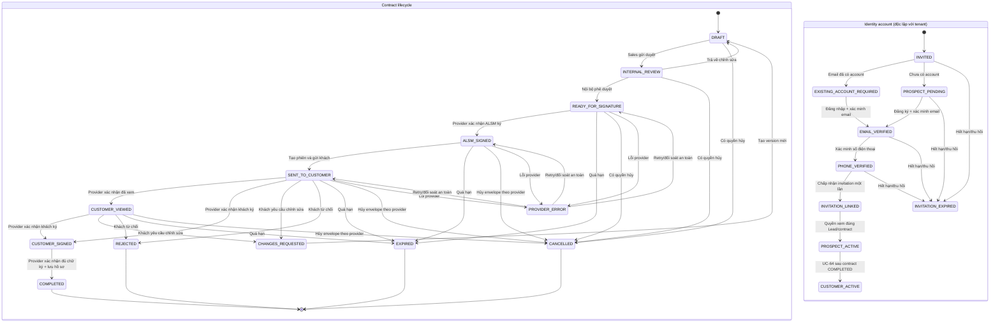

# Đặc tả nghiệp vụ và kiến trúc: ký hợp đồng online ALSM

- **Phiên bản:** 0.1 — tài liệu định hướng Bước 1
- **Ngày:** 01-11-2026
- **Phạm vi:** Đặc tả AS-IS/TO-BE và các quyết định cần chốt; chưa phải thiết kế triển khai chi tiết hay kết luận pháp lý.
- **Nguồn AS-IS:** khảo sát chỉ đọc các repository ALSM_WEB_BE, ALSM_WEB_FE_1, ALSM_WEB_FE_2 trước khi lập tài liệu.

## 1. Mục tiêu và nguyên tắc

Thiết kế luồng để Sales lập và gửi đúng hợp đồng cho đúng người; đại diện có thẩm quyền phía ALSM duyệt và ký trước; khách phải đăng nhập tài khoản ALSM, xem đúng phiên bản cuối, xác minh OTP qua số điện thoại đã xác minh và ký qua nhà cung cấp. Chỉ khi backend xác minh kết quả hoàn tất từ nhà cung cấp và lưu được hồ sơ cần thiết mới cho phép UC-64 provision Organization/tenant.

Nguyên tắc nền:

1. Tài khoản prospect là danh tính người dùng, không đồng nghĩa Organization, tenant, subscription hay quyền dùng dịch vụ.
2. Liên kết một khách với Lead phải dựa trên invitation một lần có ràng buộc ngữ cảnh và bước xác minh bổ sung; email nhập tay đơn lẻ không đủ.
3. Bản hợp đồng đã phát hành/ký bất biến. Mọi thay đổi nội dung tạo version mới và đi lại luồng duyệt/ký.
4. Chỉ coi trạng thái `COMPLETED` khi kết quả provider đã được xác thực ở backend; UI không tự chuyển hợp đồng thành đã ký.
5. Demo/sandbox và production phải tách bằng cấu hình, dữ liệu, endpoint, giao diện và nhãn trạng thái. Không trình bày dữ liệu mô phỏng như chứng cứ hoặc chữ ký thật.
6. Lỗi tích hợp không được tạo Organization hoặc làm mất trạng thái hợp đồng/bằng chứng đã ghi nhận.

## 2. AS-IS — hiện trạng khảo sát

| Khu vực | Hiện trạng quan sát được | Hệ quả cho thiết kế |
|---|---|---|
| Contract metadata | Các trường hợp đồng (số hợp đồng, tên, plan, giá, trạng thái, `envelopeId`, `signedAt`) đang nằm trong mảng `contracts` nhúng trên CRM Lead MongoDB (`ALSM_WEB_BE/src/modules/crm/infrastructure/lead.schema.ts`). | Có thể giữ tham chiếu Lead và lịch sử cũ khi chuyển sang aggregate/record hợp đồng có version; cần quyết định chiến lược chuyển dữ liệu và nguồn chân lý. |
| Tạo hợp đồng | Backend tạo bản nháp và metadata, có validation/idempotency/audit. Chưa thấy sinh tài liệu hợp đồng PDF chuẩn. | Tái sử dụng validation, audit, idempotency và liên kết Lead; bổ sung nội dung/version tài liệu bất biến. |
| Preview | FE2 render HTML tĩnh, điều khoản mẫu và nút print; không tải PDF do provider tạo. | Không thể xem đây là bản hợp đồng cuối hoặc tài liệu đã ký. |
| Gửi và ký | BE đổi trạng thái, sinh `ENV-${randomUUID()}`; API `sign` đổi thành `SIGNED` và ghi giờ. FE đặt tên hàm/nút “simulate”; UI có mã envelope `DS-ENV-...` giả, khối “Legally Executed Digital Signature” và một chuỗi lấy từ ID hiển thị như hash. | Đây là mô phỏng thao tác/trạng thái, không phải tích hợp DocuSign hay chữ ký điện tử thật. ID rút gọn không phải hash PDF. Không dùng dữ liệu này làm chứng cứ hoặc cho phép production activation. |
| Thông báo gửi hợp đồng | Backend tạo notification in-app nếu tìm được tài khoản active theo email Lead. Không thấy gửi hợp đồng qua email/SMS trong luồng này. | Notification module có thể tái sử dụng cho nhắc việc; cần thêm email và SMS provider chính thức, tracking và retry tách biệt. |
| UC-64 | `ActivateCrmLeadService` yêu cầu hợp đồng có status `SIGNED`/`FULLY_SIGNED`, rồi trong Mongo transaction tạo Organization Enterprise, liên kết user admin nếu tìm thấy theo email, cập nhật Lead `WON`, audit. Không thấy kiểm tra thanh toán tại service activation. | Ràng buộc mới phải là provider completion đã xác minh, không chỉ status. Xác nhận lại chính sách payment trước khi cho phép gọi UC-64. |
| Đăng ký FE1/BE | `AuthService.register` tạo user chưa xác minh email và đồng thời tạo Organization `SELF_SERVICE`, thêm user role `OWNER`; chỉ sau đó gửi email xác minh. | Cần tách luồng prospect registration khỏi auto-create Organization. Prospect phải được phép có user nhưng không có tenant membership/quyền dịch vụ cho tới activation. Không làm thay đổi hành vi self-service hiện hữu ngoài thiết kế được duyệt. |
| PDF/file storage | Backend có `pdfkit` cho PDF export audit log; báo giá có `pdfUrl` dạng đường dẫn, nhưng chưa thấy PDF contract generator hoặc kho hợp đồng hoàn tất. | Chọn nơi lưu private, versioned, mã hóa, retention, download authorization và kiểm tra toàn vẹn. Không suy diễn từ `pdfUrl` của quote thành file đã tồn tại. |
| Email/SMS/provider | Có SMTP adapter và cấu hình SMTP dùng trong auth/onboarding. Không thấy SMS provider, SDK/API DocuSign hoặc nhà cung cấp chữ ký đã tích hợp, webhook xác thực hay cấu hình signing provider. | SMTP sẵn có chỉ là nền để đánh giá tái sử dụng email; không thay thế dịch vụ ký, xác minh OTP hay SMS. |

**Các điểm kiểm chứng trong repository:** `crm/presentation/sales-crm.controller.ts`; `crm/application/create-contract.service.ts`; `crm/application/sales-crm.service.ts`; `crm/application/activate-crm-lead.service.ts`; `crm/infrastructure/lead.schema.ts`; FE2 `CreateContractModal.tsx`, `ContractPreviewModal.tsx`, `crm.api.ts`, `crm-store.ts`; BE `auth/application/auth.service.ts`, `auth/infrastructure/smtp-email.adapter.ts`, `notifications/notifications.service.ts`.

## 3. Luồng TO-BE tuần tự

1. **Sales khởi tạo invitation:** chọn Lead, contact, legal entity, intended signer và đúng hợp đồng/version draft. Backend xác thực quyền, tạo invitation ngẫu nhiên dùng một lần, ràng buộc với Lead, contact, email đã biết, mục đích và hạn dùng. Không đặt invitation secret vào log hoặc URL analytics.
2. **Khách tạo/dùng tài khoản prospect:** mở invitation, đăng nhập tài khoản hiện có hoặc đăng ký tài khoản prospect. Email phải xác minh; số điện thoại phải được xác minh qua SMS OTP. Xác nhận invitation một lần và kiểm tra thêm danh tính/thẩm quyền ký theo quyết định nghiệp vụ (không coi email xác minh là đủ để chứng minh đại diện pháp nhân).
3. **Liên kết account–Lead:** chỉ tiêu thụ invitation sau khi đủ điều kiện xác minh. Một invitation chỉ liên kết một user với đúng Lead; hết hạn, thu hồi, đã dùng hoặc không khớp thì từ chối an toàn. Prospect không được tạo Organization/tenant hoặc quyền truy cập dịch vụ.
4. **Soạn và duyệt nội bộ:** Sales hoàn thiện bản hợp đồng/version. Người duyệt ALSM xem toàn bộ PDF/metadata, điều khoản và người ký; phê duyệt hoặc trả về chỉnh sửa. Mọi sửa đổi sau duyệt tạo version mới và invalidate lần ký trước.
5. **ALSM ký trước:** chỉ người ký ALSM được ủy quyền mới gửi tài liệu version đã duyệt cho provider. Provider trả transaction/envelope reference và trạng thái theo API thật. Khi xác nhận ký ALSM thành công, phiên bản được khóa và chuyển sang đã ký ALSM.
6. **Gửi lời mời ký cho khách:** backend tạo phiên ký cho đúng account đã liên kết; gửi thông báo in-app và email có đường dẫn yêu cầu đăng nhập. Đường dẫn không tự cấp quyền ngoài invitation/session. Lỗi email không tạo envelope trùng; cho phép retry chỉ kênh thông báo.
7. **Khách xem và quyết định:** khách đăng nhập; backend kiểm tra invitation/Lead/contract access; hiển thị đúng bản PDF cuối, version và các bên. Khách có thể ký, từ chối hoặc yêu cầu chỉnh sửa. Yêu cầu sửa dừng phiên bản hiện tại và quay lại duyệt nội bộ; không sửa file đã gửi.
8. **OTP và ký qua provider:** khi khách chọn ký, gửi OTP tới số điện thoại đã xác minh; provider là nguồn thực hiện/ghi nhận ký theo hợp đồng API. Backend/provider xác minh OTP theo cơ chế được chốt. Không coi OTP đơn lẻ là chữ ký. Không có trạng thái ký do frontend tự đặt.
9. **Xác minh kết quả và lưu hồ sơ:** backend xác minh webhook/callback (chữ ký webhook, nguồn, transaction, contract version, trạng thái, chống replay), hoặc truy vấn provider API nếu webhook trễ. Chỉ khi provider xác nhận hoàn tất cho đủ các bên mới tải PDF cuối và chứng cứ provider thực sự cung cấp; lưu private, bất biến, versioned và hash trên bytes file để kiểm tra toàn vẹn.
10. **Thông báo hai bên:** sau khi hồ sơ lưu thành công, gửi notification in-app và email tới khách cùng đại diện ALSM, chứa link yêu cầu đăng nhập để tải bản hoàn tất. Không gửi OTP trong thông báo hoàn tất.
11. **UC-64 activation:** chỉ backend gọi UC-64 từ hợp đồng `COMPLETED` có provider reference đã xác minh, PDF/evidence đã lưu, Lead đúng contract version và đủ điều kiện payment/kinh doanh đã chốt. UC-64 idempotent theo contract/Lead; prospect chỉ được liên kết với Organization/tenant khi activation thành công.

### 3.1 Sequence diagram

```mermaid
sequenceDiagram
    autonumber
    actor Sales as Sales
    actor Reviewer as Người duyệt ALSM
    actor ALSMSigner as Người ký ALSM
    actor Customer as Khách prospect
    participant FE as Web 2 / Web 1
    participant BE as ALSM Backend
    participant DB as MongoDB / private file store
    participant Mail as Email + SMS provider
    participant Sign as Signing provider
    participant UC64 as UC-64 provisioning

    Sales->>FE: Tạo lời mời cho đúng Lead/contact
    FE->>BE: Tạo invitation
    BE->>DB: Lưu invitation hash, hạn dùng, Lead, signer
    BE-->>Mail: Gửi email invitation (không mật khẩu)
    Mail-->>Customer: Invitation link
    Customer->>FE: Đăng nhập / tạo prospect account
    FE->>BE: Xác minh email và số điện thoại
    BE-->>Mail: Gửi SMS OTP xác minh số điện thoại
    Customer->>FE: Nhập OTP, chấp nhận invitation
    FE->>BE: Consume invitation một lần, liên kết account–Lead
    BE->>DB: Ghi liên kết; không tạo Organization

    Sales->>BE: Tạo version hợp đồng
    Reviewer->>FE: Duyệt nội dung/version
    FE->>BE: Approve / trả về chỉnh sửa
    BE->>DB: Khóa version đã duyệt
    ALSMSigner->>FE: Ký trước version đã duyệt
    FE->>BE: Khởi tạo signing session ALSM
    BE->>Sign: Tạo envelope với tài liệu/version chuẩn
    Sign-->>BE: ALSM signature event/reference
    BE->>BE: Xác minh sự kiện và trạng thái
    BE->>DB: Ghi ALSM_SIGNED + audit

    BE-->>Mail: Gửi in-app + email lời mời khách
    Mail-->>Customer: Link yêu cầu đăng nhập
    Customer->>FE: Đăng nhập, xem PDF/version
    FE->>BE: Tải đúng hợp đồng đã liên kết
    Customer->>FE: Ký / từ chối / yêu cầu chỉnh sửa
    FE->>BE: Yêu cầu ký
    BE-->>Mail: Gửi OTP tới điện thoại đã xác minh
    Mail-->>Customer: OTP
    Customer->>Sign: Xác minh OTP và ký trên provider
    Sign-->>BE: Webhook kết quả (có xác thực)
    BE->>Sign: Truy vấn đối soát nếu cần
    BE->>BE: Xác thực đủ bên ký, version, transaction
    BE->>Sign: Tải PDF hoàn tất + chứng cứ provider có
    Sign-->>BE: PDF/evidence
    BE->>DB: Lưu file bất biến, checksum, audit
    BE-->>Customer: Thông báo hoàn tất + link tải
    BE-->>ALSMSigner: Thông báo hoàn tất + link tải
    BE->>UC64: Chỉ kích hoạt sau trạng thái COMPLETED
    UC64->>DB: Provision Organization/tenant idempotent
```

### 3.2 Trạng thái hợp đồng và tài khoản



**Diễn giải trạng thái:** `READY_FOR_SIGNATURE` nghĩa là nội dung đã duyệt và sẵn sàng vào provider, chưa có chữ ký. `ALSM_SIGNED`/`CUSTOMER_SIGNED` chỉ được đặt khi backend đã xác minh provider xác nhận chữ ký tương ứng. `COMPLETED` là trạng thái đủ chữ ký, xác minh được, và đã lưu hồ sơ hoàn tất. `PROVIDER_ERROR` giữ nguyên tiến độ đã xác minh; retry không tạo giao dịch/envelope mới nếu provider đã nhận yêu cầu.

**Tách tài khoản và tenant:** `PROSPECT_ACTIVE` chỉ là tài khoản đăng nhập được và xem đúng hồ sơ được mời. Không có Organization membership, project, subscription hoặc quyền truy cập dịch vụ. `CUSTOMER_ACTIVE` chỉ hình thành qua activation thành công; lưu provider completion ID để chống kích hoạt sớm/trùng.

## 4. Vai trò và quyền

| Vai trò | Quyền nghiệp vụ đề xuất | Giới hạn bắt buộc |
|---|---|---|
| Sales | Tạo/cập nhật draft trước phát hành; tạo, gửi lại hoặc thu hồi invitation theo chính sách; xem trạng thái Lead/contract được phân công; yêu cầu duyệt. | Không tự duyệt nội dung của mình nếu quy tắc phân tách nhiệm vụ yêu cầu; không đánh dấu đã ký; không tải hợp đồng Lead khác. |
| Người duyệt ALSM | Đọc toàn bộ version chờ duyệt; approve hoặc trả về có lý do; xem lịch sử thay đổi. | Không sửa trực tiếp version đã trình; bản sửa tạo version mới. Tách biệt với người soạn khi chính sách yêu cầu. |
| Người ký ALSM | Chỉ ký version đã duyệt, đúng pháp nhân/ủy quyền; hủy hoặc từ chối phiên ký theo policy. | Không thể ký version khác với version đã duyệt; mọi thao tác phải được provider xác nhận và audit. |
| Khách prospect | Đăng nhập; xem đúng Lead/contract/version được liên kết qua invitation; xem terms; ký, từ chối hoặc yêu cầu sửa; tải PDF hoàn tất nếu được cấp. | Không liệt kê/tìm kiếm Lead; không xem khách khác; không có Organization/tenant/project/subscription/service access trước activation. |
| Khách đã kích hoạt | Quyền khách theo Organization membership/RBAC hiện hành; truy cập hợp đồng của tổ chức mình theo chính sách. | Không kế thừa quyền prospect rộng hơn tenant; không xem dữ liệu tổ chức khác. |
| Quản trị viên | Quản trị cấu hình, vai trò, truy cập và hỗ trợ; tra cứu hồ sơ theo quyền/nhu cầu audit. | Không tự ký thay, sửa PDF, giả lập callback hoặc bỏ qua provider completion. Break-glass phải có lý do và audit. |
| Nhà cung cấp ký | Tạo phiên ký, thực hiện OTP/ký nếu dịch vụ hỗ trợ, phát trạng thái, trả PDF/evidence. | Tích hợp service-to-service tối thiểu; webhook được xác minh; không có quyền truy cập trực tiếp dữ liệu ngoài giao dịch đã cấp. |

**Permission keys đề xuất để review, chưa chốt tên kỹ thuật:** `crm.contracts.create`, `crm.contracts.submit-review`, `crm.contracts.approve`, `crm.contracts.sign-alsm`, `crm.contracts.invite-customer`, `crm.contracts.view-assigned`, `crm.contracts.customer.view-invited`, `crm.contracts.customer.sign`, `crm.contracts.activate`, `crm.contracts.audit.view`. Phải áp dụng kiểm tra theo resource/Lead/version ở backend; ẩn nút ở UI không thay thế authorization.

## 5. Quy tắc dữ liệu và an toàn

### 5.1 Invitation, identity và account

- Sinh secret đủ entropy bằng CSPRNG; chỉ lưu hash/metadata cần thiết. Secret chỉ dùng một lần, có `expiresAt`, `revokedAt`, `consumedAt`, trạng thái và purpose.
- Ràng buộc invitation với Lead ID, người nhận dự kiến, email, intended signer/organization, contract/version nếu đã có. Không cho client tự đổi Lead hoặc signer trong lúc consume.
- Với account hiện hữu: yêu cầu đăng nhập đúng account, xác minh email và số điện thoại; kiểm tra invitation chưa dùng/còn hạn và xác nhận identity/thẩm quyền theo mức đã được chốt.
- Với account mới: tạo user prospect chưa xác minh; xác minh email/phone rồi mới consume invitation và cấp quyền xem tối thiểu. Không tạo `SELF_SERVICE` Organization cho nhánh prospect.
- Không tạo trùng user: email normalize, unique constraint, xử lý race bằng idempotent upsert/transaction. Account hiện hữu không tự đổi chủ sở hữu hoặc membership chỉ nhờ invitation email.
- Hết hạn/thu hồi: token cũ không thể dùng. Gửi lại tạo token mới và vô hiệu token cũ. Rate-limit, chống dò email và trả thông báo không tiết lộ account có tồn tại hay không.
- Không gửi mật khẩu. Không ghi plaintext invitation token, OTP, access token, refresh token, provider secret hay nội dung xác thực nhạy cảm vào log, analytics, URL referrer hoặc notification text.

### 5.2 Bất biến hợp đồng và quyền truy cập

- Mỗi hợp đồng có `contractId`, Lead liên kết, `version`, mẫu/điều khoản phiên bản, signer manifest, trạng thái, provider reference và timestamps.
- Sau khi phát hành ký, snapshot nội dung + PDF + signer manifest bất biến. Sửa điều khoản/số tiền/người ký tạo version mới, yêu cầu duyệt lại, hủy hoặc invalidate envelope cũ theo API provider và tạo phiên mới.
- Kiểm tra mọi lần đọc/tải ở backend theo user, invitation/contract/version và trạng thái; dùng URL tải có thời hạn hoặc proxy backend có authorization. Không để file public.
- Callback/webhook phải xác thực cryptographic signature/secret theo tài liệu provider, kiểm tra timestamp/nonce/replay, environment, tenant/account provider, event type, contract/version, signer và transaction ID. Idempotent theo provider event ID và transaction.
- Phân tách sandbox/production bằng credentials, callback host, storage namespace, database labels, provider account và UI badge rõ ràng. Sandbox không thể trigger production UC-64.
- Log audit sự kiện nghiệp vụ: actor, action, contract/version, provider event/transaction ID, thời gian UTC, kết quả và request correlation ID; không log payload bí mật hoặc OTP. Có kiểm soát sửa/xóa và truy cập audit.
- Retry notification không retry tạo envelope; retry provider phải đối soát trạng thái trước, dùng idempotency key tương ứng nếu API hỗ trợ.

### 5.3 Khái niệm cần phân biệt

| Khái niệm | Ý nghĩa trong thiết kế | Không được suy diễn thành |
|---|---|---|
| OTP | Mã dùng một lần để xác minh quyền kiểm soát kênh/số điện thoại hoặc bước xác thực trong provider; có thời hạn, giới hạn lần thử và chống replay. | Tự thân là chữ ký điện tử hoặc chứng cứ đầy đủ rằng người có thẩm quyền đã chấp thuận nội dung hợp đồng. |
| Chữ ký điện tử | Dữ liệu điện tử liên kết logic với thông điệp dữ liệu, có khả năng xác nhận người ký và sự chấp thuận nội dung; cần đánh giá quy trình và provider cụ thể. | Mọi thao tác click, OTP hoặc ảnh chữ ký đều tự động có cùng giá trị/phương thức pháp lý. |
| Chữ ký số | Một dạng chữ ký điện tử dùng cơ chế mật mã/khóa và có thể gắn với chứng thư/dịch vụ chứng thực theo quy định áp dụng. | Đồng nghĩa với mọi chữ ký điện tử hoặc luôn là lựa chọn bắt buộc cho mọi hợp đồng. |
| Ảnh chữ ký | Ảnh/đồ họa chữ ký hiển thị trên trang PDF. | Bằng chứng duy nhất đủ để xác minh danh tính, ý chí, tính toàn vẹn hoặc thẩm quyền ký. |
| Audit log | Ghi nhận ai/lúc nào/thao tác nào và kết quả theo nguồn tin cậy, hỗ trợ truy nguyên. | Chữ ký, chứng thư hoàn tất hoặc bằng chứng provider. |
| Hash/checksum file | Giá trị tính trên chính bytes của file theo thuật toán đã chọn để phát hiện thay đổi khi đối chiếu. | Tự chứng minh ai ký, thời điểm ký, sự chấp thuận, nguồn gốc hoặc giá trị pháp lý. |

## 6. Hồ sơ sau ký và lưu trữ

Chỉ lưu mục nào provider thực sự trả về hoặc hệ thống có thể chứng minh đã tạo ra từ sự kiện xác thực; không tự sinh certificate, provider ID, timestamp ký hoặc thông tin danh tính để trình bày như chứng thư provider.

Hồ sơ theo contract/version nên có:

- PDF hoàn tất cuối cùng đúng version; metadata provider document ID và thời điểm tải.
- Biên nhận/chứng thư completion nếu provider hỗ trợ; giữ nguyên bản gốc provider trả về.
- Contract ID/number/version, mã template và checksum của bản đã phát hành trước khi ký.
- Người ký, vai trò/bên ký, phương thức xác minh được provider ghi nhận, trạng thái và kết quả; lưu tối thiểu cần thiết.
- Các mốc thời gian: duyệt, ALSM ký, gửi, xem, yêu cầu OTP (không lưu mã OTP), ký khách, hoàn tất, tải hồ sơ, thông báo và activation.
- Provider name/environment, transaction/envelope ID, provider event ID, correlation/idempotency IDs; webhook raw payload chỉ lưu nếu có căn cứ, kiểm soát truy cập và loại bỏ secrets/OTP.
- Hash toàn file PDF và từng evidence artifact sau khi nhận; thuật toán, thời điểm tính, version và nơi lưu để kiểm tra toàn vẹn.
- Nhật ký gửi/nhận, kết quả gửi email/SMS, retries, trạng thái tải file và lịch sử thay đổi trạng thái.
- Quyền tải, retention schedule, legal hold, backup/restore, xóa theo chính sách và audit truy cập/tải.

Lưu trong private object storage/repository đã được phê duyệt; file key không chứa PII trực tiếp. Mã hóa khi truyền/lưu, kiểm soát access bằng backend, versioning/immutability theo yêu cầu đã quyết định. Không đưa tài liệu hợp đồng vào localStorage hoặc public URL.

## 7. Bảng lỗi và xử lý

| Tình huống | Hành vi và trạng thái | Retry / audit |
|---|---|---|
| Account chưa xác minh email | Chặn xem/ký; yêu cầu hoàn tất xác minh; không consume invitation. | Resend có rate limit; audit sự kiện không chứa token. |
| Email sai/không khớp invitation | Không liên kết account; thông báo tổng quát, không tiết lộ account khác. | Sales xác minh lại contact rồi thu hồi/gửi invitation mới; audit actor/reason. |
| Số điện thoại sai/chưa xác minh | Không cho ký; yêu cầu sửa theo quy trình kiểm soát và xác minh số mới. | OTP rate limit, cooldown và giới hạn lần thử; không log OTP. |
| Người ký không có thẩm quyền | Không cấp ký hoặc chuyển sang chờ xác minh/ủy quyền; không gửi envelope production. | Tạo yêu cầu xác minh authority; giữ contract version, audit. |
| Link/invitation hết hạn hoặc thu hồi/đã dùng | Từ chối; không đổi trạng thái hợp đồng. | Sales phát invitation mới theo quyền; token cũ vô hiệu vĩnh viễn. |
| OTP sai/hết hạn/vượt số lần | Không ký; khóa tạm thời hoặc yêu cầu provider tạo challenge mới theo policy. | Chỉ retry challenge hợp lệ; audit kết quả, không lưu mã. |
| Khách từ chối | `REJECTED` sau khi provider xác nhận; không activation. | Muốn gửi lại phải có version/flow mới và quyết định xử lý refusal. |
| Khách yêu cầu chỉnh sửa | `CHANGES_REQUESTED`; đóng/đóng băng phiên bản đang gửi; quay lại Sales/reviewer. | Version mới, duyệt lại, envelope mới; giữ lịch sử cũ. |
| Webhook sai chữ ký/nguồn | Bỏ qua, không chuyển trạng thái; cảnh báo vận hành. | Không retry tin webhook không xác thực; lưu metadata an toàn phục vụ điều tra. |
| Webhook chậm/mất | Giữ trạng thái đã xác minh gần nhất; hiển thị “đang chờ xác nhận”. | Job đối soát bằng provider API; không cho activation khi chưa hoàn tất. |
| Webhook trùng/replay | Idempotently bỏ qua; không lặp thông báo, file hay activation. | Unique provider event ID + idempotency key; audit lần nhận. |
| Provider unavailable/timeout | Không giả lập thành đã gửi/ký; `PROVIDER_ERROR` hoặc pending theo API. | Đọc trạng thái trước khi retry; backoff; không tạo envelope trùng. |
| Email/SMS lỗi | Ghi kết quả delivery; không suy ra khách đã nhận/xem/ký. | Retry riêng kênh delivery; không gửi lại thao tác ký/envelope. |
| Tải PDF/evidence lỗi | Chưa chuyển `COMPLETED` và chưa gọi UC-64 cho tới khi lưu đủ hồ sơ bắt buộc. | Retry tải có đối soát ID/checksum; giữ provider completion event xác thực. |
| UC-64 bị gọi sớm | Backend từ chối nếu không có `COMPLETED`, provider verification và evidence-ready. | Idempotency theo contract/Lead; audit lần từ chối; chỉ retry sau khi đủ điều kiện. |
| UC-64 timeout sau commit | Đọc trạng thái provisioning theo contract/Lead trước khi thử lại. | Idempotent transaction/reconciliation; không tạo Organization trùng. |
| Sai version/tài liệu hash | Chặn completion; quarantine hồ sơ, mở incident. | Đối soát tài liệu/provider transaction; không thay file âm thầm. |

## 8. Tiêu chí nghiệm thu theo vai trò

### Sales

- Có thể tạo invitation cho một Lead/contact cụ thể; payload không cho phép khách đổi Lead.
- Xem invitation state, hết hạn, thu hồi, đã dùng, lỗi email và trạng thái ký/provider.
- Resend/thu hồi có quyền, ghi audit; resend không tạo account/tenant trùng hoặc envelope trùng.
- Không có nút hay API nào cho Sales tự đặt status ký/completed.

### Người duyệt ALSM

- Xem chính xác PDF/version, signer, giá trị và điều khoản trước khi duyệt.
- Approve/return yêu cầu lý do; sau khi duyệt, mọi nội dung thay đổi tạo version mới và buộc duyệt lại.
- Có thể truy lại ai duyệt version nào, thời gian và kết quả.

### Người ký ALSM

- Chỉ nhận version được duyệt và đúng thẩm quyền; provider xác nhận chữ ký mới tiến trạng thái.
- Thao tác timeout/replay không tạo chữ ký/envelope lặp; xem trạng thái đối soát.

### Khách prospect

- Phải đăng nhập và xác minh email/số điện thoại theo policy trước khi xem/ký.
- Chỉ truy cập hồ sơ được mời; không thể liệt kê Lead, xem hồ sơ khách khác, project, tenant hay subscription.
- Có thể xem PDF/version cuối và chọn ký/từ chối/yêu cầu chỉnh sửa; khách yêu cầu sửa/từ chối không trigger activation.
- OTP đến đúng số đã xác minh; trạng thái ký chỉ xuất hiện sau xác nhận provider.
- Prospect account không tự tạo Organization hoặc quyền dịch vụ.

### Khách đã kích hoạt

- Sau provider completion và UC-64 thành công, được liên kết Organization phù hợp và tải được PDF/evidence theo quyền.
- Tài liệu thuộc Organization khác bị từ chối ở API, kể cả sửa URL/ID.

### Quản trị viên / vận hành

- Phân quyền và truy cập có audit; không thể chỉnh sửa bằng chứng hoàn tất hoặc bypass provider verification.
- Dashboard/alert phân biệt pending, provider error, webhook invalid, delivery failure, file failure và UC-64 reconciliation.
- Sandbox có nhãn dễ nhận biết, dữ liệu/credentials riêng, không gọi production activation.

### Nhà cung cấp và tích hợp

- Webhook kiểm tra authentication/signature, event identity, replay, environment, contract/version và signer.
- Duplicate events, out-of-order events, callback retry, timeout và provider query reconciliation cho kết quả xác định, không nhân đôi side effect.
- Chỉ provider completion đã xác minh + evidence đã lưu mới có thể tạo điều kiện UC-64.

## 9. Câu hỏi/chốt quyết định còn thiếu

1. **Signing provider:** chọn nhà cung cấp nào? **MATBAO Sign chỉ là ứng viên được nhắc theo ảnh, chưa xác nhận.** Provider có ký tuần tự, ký đại diện doanh nghiệp, OTP SMS, sandbox, webhook/API truy vấn, PDF hoàn tất và chứng thư/biên nhận không?
2. **Tài liệu/API/credentials:** tài liệu API chính thức, auth/OAuth/API key, webhook signing guide, sandbox account và sandbox credentials, giới hạn API, SLA, phí, data residency, production onboarding. Không đưa credentials thật vào repo/tài liệu.
3. **SMS provider:** đơn vị gửi, sender ID/brandname, OTP template, hạn dùng, giới hạn thử, vùng gửi và chi phí; ai chịu trách nhiệm xác minh số điện thoại.
4. **Email:** xác nhận SMTP hiện tại có thể dùng production không, domain/DKIM/SPF, template/legal copy, delivery/bounce tracking và link đăng nhập an toàn.
5. **Hợp đồng:** mẫu và điều khoản được pháp chế duyệt; trường dữ liệu; ngôn ngữ; quy tắc đánh số; phiên bản; phụ lục; loại giao dịch/điều khoản cần ký nháy.
6. **Người ký:** đại diện pháp nhân hai bên, ủy quyền, số lượng người ký, thứ tự, thay thế người ký, kiểm chứng tư cách đại diện và trường hợp cá nhân nước ngoài.
7. **Thời điểm hiệu lực:** thời điểm tạo nghĩa vụ/hợp đồng có hiệu lực; có phụ thuộc ngày ký cuối, thanh toán, bàn giao hay sự kiện khác không.
8. **UC-64 và thanh toán:** điều kiện chính xác để activation; có cần confirmed payment/waiver, invoice hay sales approval nữa không; ai xác nhận nguồn thanh toán; quy trình rollback/reconciliation.
9. **Tài khoản prospect:** có cho đăng ký tự do hay chỉ invitation; cần xác minh danh tính/eKYC nào; cách tách luồng self-service hiện đang tự tạo Organization.
10. **File store/retention:** nơi lưu (cloud/on-prem, quốc gia/region), encryption/KMS, access model, retention, legal hold, backup, deletion, tải xuống và lưu bản gốc/evidence.
11. **Phân môi trường:** cách gắn nhãn demo/sandbox trong UI/API, dữ liệu thử, tên miền callback và biện pháp kỹ thuật ngăn sandbox gọi UC-64 production.
12. **Vận hành:** ai xử lý provider error/dispute, webhook outage, signer change, cancellation, provider account shutdown; SLA và escalation.

## 10. Checklist pháp lý cần chuyên gia rà soát

Đây là danh sách câu hỏi để bộ phận pháp chế/chuyên gia Việt Nam kiểm tra theo loại hợp đồng và mô hình provider; **không phải tư vấn hay kết luận rằng một phương thức chữ ký cụ thể có hiệu lực pháp lý**.

- [ ] Rà soát Luật Giao dịch điện tử 2023 (Luật 20/2023/QH15; đã có Văn bản hợp nhất 36/VBHN-VPQH năm 2026): loại thông điệp dữ liệu, yêu cầu truy cập/tham chiếu, tính toàn vẹn, khả năng xác định người khởi tạo, lưu trữ, chứng cứ và điều kiện an toàn của chữ ký điện tử.
- [ ] Rà soát Nghị định 23/2025/NĐ-CP về chữ ký điện tử và dịch vụ tin cậy; xác định provider/dịch vụ được sử dụng, quy trình kiểm chứng chữ ký/chứng thư, phạm vi công nhận, lưu trữ và nghĩa vụ các bên liên quan.
- [ ] Rà soát Bộ luật Dân sự 2015 (91/2015/QH13): năng lực chủ thể, đại diện/ủy quyền, đề nghị–chấp nhận, hình thức hợp đồng, thời điểm giao kết/hiệu lực, giao dịch vô hiệu, lưu giữ và giải quyết tranh chấp.
- [ ] Rà soát Luật Bảo vệ dữ liệu cá nhân 2025 (91/2025/QH15, hiệu lực 01-01-2026) cùng văn bản hướng dẫn/chuyển tiếp còn hiệu lực tại ngày triển khai; xác định vai trò controller/processor, căn cứ xử lý, thông báo/đồng ý khi cần, mục đích, tối thiểu hóa, quyền chủ thể, bảo vệ, sự cố, lưu giữ/xóa và chuyển dữ liệu xuyên biên giới.
- [ ] Đánh giá dữ liệu định danh, số điện thoại, OTP, chữ ký, hồ sơ doanh nghiệp và tài liệu hợp đồng có được provider xử lý ở nước ngoài; hợp đồng xử lý dữ liệu, subprocessors, nơi lưu, quyền truy cập và cơ chế chuyển dữ liệu.
- [ ] Xác định quy định chuyên ngành/hình thức bắt buộc nếu hợp đồng thuộc ngành hàng, giao dịch hoặc loại tài liệu đặc thù; không áp dụng một kết luận chung cho mọi loại hợp đồng ALSM.
- [ ] Rà soát cơ chế chứng minh authority người ký doanh nghiệp; phân biệt người kiểm soát số điện thoại với người có thẩm quyền đại diện.
- [ ] Rà soát giá trị chứng cứ của provider audit trail, OTP evidence, timestamp, PDF, email delivery, event logs, hash, bản gốc và quy trình xuất trình khi tranh chấp.
- [ ] Chốt thời hạn lưu hồ sơ, retention/legal hold, hủy dữ liệu sau thời hạn, bản sao dự phòng và quyền tải/xuất hồ sơ.
- [ ] Phê duyệt điều khoản đồng ý giao dịch điện tử, phương thức thông báo, ngôn ngữ/địa điểm giao kết, thay đổi/hủy, từ chối và tranh chấp trong mẫu hợp đồng.

Văn bản tham chiếu từ Cổng thông tin chính thức (cần kiểm tra bản hiện hành và hướng dẫn khi triển khai):

- [Luật Giao dịch điện tử 20/2023/QH15](https://vanban.chinhphu.vn/?classid=1&docid=208421&pageid=27160&typegroupid=3)
- [Văn bản hợp nhất 36/VBHN-VPQH năm 2026 — Luật Giao dịch điện tử](https://vanban.chinhphu.vn/?docid=217207&pageid=27160)
- [Nghị định 23/2025/NĐ-CP — chữ ký điện tử và dịch vụ tin cậy](https://vanban.chinhphu.vn/?classid=1&docid=212829&pageid=27160)
- [Bộ luật Dân sự 91/2015/QH13](https://vanban.chinhphu.vn/?classid=&docid=183188&pageid=27160)
- [Luật Bảo vệ dữ liệu cá nhân 91/2025/QH15](https://vanban.chinhphu.vn/?classid=1&docid=214590&pageid=27160&typegroup=)
- [Nghị định 13/2023/NĐ-CP — cần chuyên gia xác định phạm vi áp dụng/chuyển tiếp sau Luật 91/2025/QH15](https://vanban.chinhphu.vn/?docid=207759&pageid=27160)

## 11. Đề xuất phạm vi Bước 2

Trước khi viết code, hoàn thành một **decision package** ngắn được Business, Legal, Security và Engineering cùng xác nhận:

1. Chốt provider ký, capability matrix, tài liệu API và sandbox test account; xác nhận signing flow/OTP/webhook/evidence.
2. Chốt mẫu hợp đồng, người ký/ủy quyền, approval matrix, thời điểm hiệu lực, điều kiện payment và activation.
3. Chốt prospect identity flow và sửa đổi nghiệp vụ cần có để đăng ký prospect không tạo Organization; không làm ảnh hưởng luồng self-service hiện hành.
4. Chốt file store/region, retention, threat model, dữ liệu cá nhân và quy trình xử lý yêu cầu truy cập/xóa.
5. Tạo thiết kế kỹ thuật có API contract, state transition guard, data model/versioning, provider adapter interface, webhook verification/idempotency, event/reconciliation, notification delivery, activation gate và migration/compatibility plan.
6. Chốt acceptance scenarios và environment strategy phân biệt demo/sandbox/production trước khi bắt đầu Bước 3 (triển khai).

**Không đưa vào Bước 2 một giả định rằng MATBAO Sign đã được chọn hoặc rằng OTP/ảnh chữ ký/hash tự tạo đủ điều kiện pháp lý.**
